# Лаба 2 — Мониторинг сервиса: метрики, логи, трейсы


## Часть 0 — Свой сервис

Напиши сервис — свой или сгенерированный, реализация на оценку не влияет. Нужен HTTP-сервис `api` с эндпоинтами, чтобы самому провоцировать ситуации:

- `GET /health` — возвращает `ok`;
- `GET /fail` — возвращает ошибку 5xx и увеличивает счётчик ошибок;
- `GET /slow` — отвечает медленно (спит 1–3 секунды);
- `GET /load` — делает пачку запросов к себе, чтобы подскочил RPS.

Сервис должен:

- отдавать метрики Prometheus на `/metrics`: счётчик запросов, счётчик ошибок, гистограмму времени ответа (RED);
- писать структурированные логи в JSON с `trace_id` текущего запроса;
- быть инструментирован OpenTelemetry для трейсов (см. часть 3);
- иметь Dockerfile.

Работаем только в Kubernetes: подними локальный кластер (minikube, kind или другую инсталляцию) и весь стек разворачивай через Helm. Других вариантов (docker compose и подобное) в этой лабе не используем.

```
minikube start --driver=kvm --cpus=5 --memory=12288 --disk-size=10g
kubectl create namespace tracing
helm repo add jaegertracing https://jaegertracing.github.io/helm-charts
helm repo update

helm repo add jetstack https://charts.jetstack.io
helm repo update

# Устанавливаем cert-manager с CRD в отдельный namespace
helm install cert-manager jetstack/cert-manager \
  --namespace cert-manager \
  --create-namespace \
  --set installCRDs=true

helm install jaeger jaegertracing/jaeger-operator -n tracing \
  --create-namespace \
  --set rbac.clusterRole=true \
  --set jaeger.create=false

kubectl wait --for=condition=ready pod -l app.kubernetes.io/name=jaeger-operator -n tracing --timeout=60s

helm upgrade jaeger jaegertracing/jaeger-operator -n tracing \
  --set jaeger.create=true \
  --set jaeger.spec.storage.type=memory

kubectl create namespace incident

helm repo add prometheus-community https://prometheus-community.github.io/helm-charts
helm repo update
helm install prometheus prometheus-community/kube-prometheus-stack \
  --namespace monitoring \
  --create-namespace \
  --set prometheus.prometheusSpec.serviceMonitorSelectorNilUsesHelmValues=false

helm install incident-service ./incident-trigger-service/helm/incident-service \
  -n incident \
  --set otel.jaegerEndpoint="http://jaeger-jaeger-operator-jaeger-collector.tracing.svc.cluster.local:4317"
```
```
# Поды
kubectl get pods -n incident

# Проброс порта для теста
kubectl port-forward -n incident svc/incident-service 8000:8000 &
```
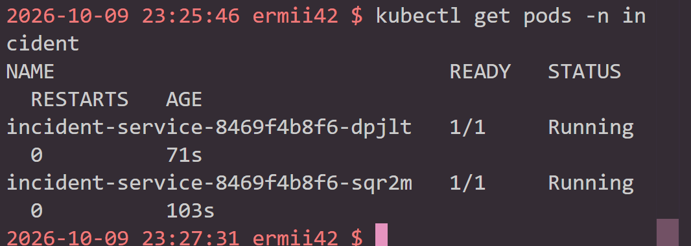

```
kubectl port-forward -n tracing svc/jaeger-jaeger-operator-jaeger-query 16686:16686 --address 0.0.0.0
```
## Часть 1 — Метрики (Prometheus + Grafana)

Подними Prometheus и настрой scrape `/metrics` сервиса. Подними Grafana, подключи Prometheus как источник. Собери дашборд по RED: интенсивность запросов, доля ошибок, p95 времени ответа. Понажимай `/load`, `/fail`, `/slow` и убедись, что графики реагируют.

Установка kube-prometheus-stack
```
helm repo add prometheus-community https://prometheus-community.github.io/helm-charts
helm repo update

helm install monitoring prometheus-community/kube-prometheus-stack \
  -n monitoring --create-namespace
```
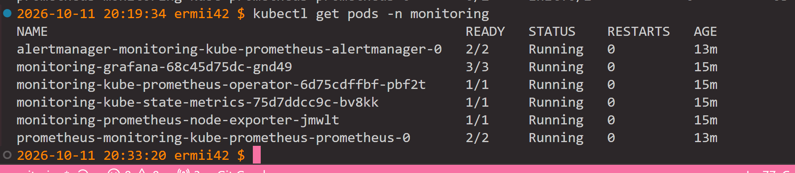

```
kubectl port-forward -n monitoring svc/monitoring-grafana 3001:80 --address 0.0.0.0
```
Для получения сгенерированного админ-пароля
```
kubectl get secret --namespace monitoring monitoring-grafana -o jsonpath="{.data.admin-password}" | base64 --decode ; echo
```

**Настройка scrape /metrics сервиса**
сервис отдаёт метрики на /metrics порта 8000. Чтобы Prometheus их собирал, нужен ServiceMonitor — это CRD от Prometheus Operator.
Создайте файл servicemonitor.yaml:

Применяем
```
kubectl apply -f ./incident-trigger-service/helm/incident-service/templates/servicemonitor.yaml
```
Проверка, что Prometheus видит таргет: откройте Prometheus UI:

```
kubectl port-forward -n monitoring svc/monitoring-kube-prometheus-prometheus 9091:9090 --address 0.0.0.0
```
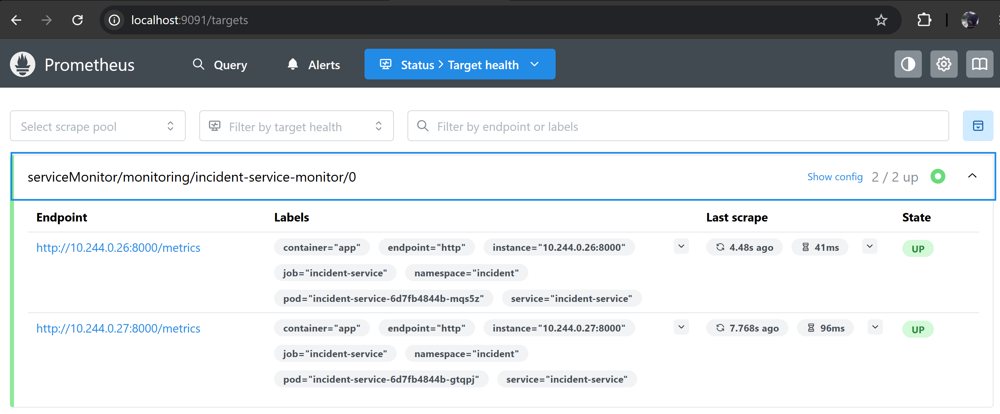

**Дашборд RED**
Панель 1 — Rate (RPS)
Название: в правом верхнем углу панели поставьте RPS — Request Rate.

Query (в поле «Metrics browser» или просто вбейте):

promql
sum(rate(http_requests_total{job="incident-service"}[1m]))
Разбор:

http_requests_total — ваш Counter из app/metrics.py.

{job="incident-service"} — фильтр по job'у. Имя job'а Prometheus присваивает автоматически из имени ServiceMonitor/target'а. Если не уверены — проверьте в Prometheus UI (Status → Targets) или уберите фильтр на время отладки.

rate(...[1m]) — скорость прироста счётчика за окно 1 минута. Результат — «запросов в секунду».

sum(...) — суммируем по всем лейблам (method, endpoint, status_code), чтобы получить общий RPS.

Настройки панели:

Unit: reqps (requests per second) — правая панель → Standard options → Unit → Throughput → reqps.

Legend: можно оставить {{method}} {{endpoint}} если хотите разбивку, но у нас sum() — легенда не нужна.

Применить: кнопка Apply справа сверху.

3.3. Панель 2 — Errors (доля ошибок в %)
Add → Visualization (в том же дашборде).

Название: Error Rate %.

Query:

promql
100 * sum(rate(http_requests_total{job="incident-service", status_code=~"5.."}[1m]))
    / sum(rate(http_requests_total{job="incident-service"}[1m]))
Разбор:

Числитель — RPS запросов со статусом 5xx (=~"5.." — regex, 5xx).

Знаменатель — общий RPS.

100 * — переводим долю в проценты.

Настройки:

Unit: percent (Standard options → Unit → Misc → percent).

Thresholds (по желанию):

зелёный: 0

жёлтый: 5 (при 5% ошибок — warning)

красный: 10
Чтобы настроить: правая панель → Thresholds → Add threshold.

Min: 0, Max: 100 (Standard options → Min/Max).

Apply.

3.4. Панель 3 — Duration (p95 latency)
Add → Visualization.

Название: p95 Latency.

Query:

promql
histogram_quantile(0.95,
  sum(rate(http_request_duration_seconds_bucket{job="incident-service"}[5m])) by (le)
)
Разбор:

Ваш Histogram из app/metrics.py под капотом экспортирует три серии: _bucket, _sum, _count.

_bucket имеет лейбл le («less or equal») — границу бакета.

sum(rate(..._bucket[5m])) by (le) — суммируем по всем остальным лейблам, оставляя только le.

histogram_quantile(0.95, ...) — считает 95-й перцентиль.

Настройки:

Unit: seconds (или milliseconds для наглядности — тогда значение будет крупнее).

Legend: p95.

Apply.

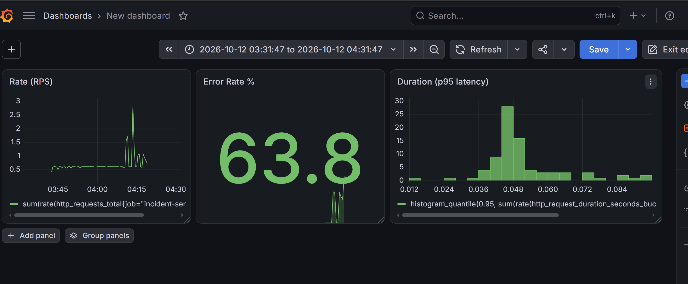

## Часть 2 — Логи (Loki + Grafana)

Сначала пойми разделение ролей: Loki — это хранилище логов, сам он ниоткуда логи не забирает. Собирает вывод подов и отправляет его в Loki отдельный агент, который ставится на каждую ноду, — например Grafana Alloy, Promtail или Fluent Bit. То есть нужно поднять и Loki, и такой агент-сборщик.

Подними Loki и агент сбора, настрой сбор логов сервиса и подключи Loki к той же Grafana, чтобы метрики и логи были в одном окне. Дёрни `/fail` и найди эту ошибку в логах.

```
# Добавляем репозиторий Grafana (если ещё не добавлен)
helm repo add grafana https://grafana.github.io/helm-charts
helm repo update

# Ставим Loki в неймспейс monitoring
helm install loki grafana/loki -n monitoring -f ./incident-trigger-service/helm/incident-service/loki-values.yaml
```
Установка Grafana Alloy (агент сбора логов)
```
helm install alloy grafana/alloy -n monitoring \
  --set controller.type=daemonset \
  --set alloy.configMap.create=true
```
Настройка Alloy для сбора логов сервиса
Создайте файл alloy-config.alloy со следующим содержимым:

Примените конфиг:
```
kubectl create configmap alloy-config \
  --from-file=config.alloy=./incident-trigger-service/alloy-config.alloy \
  -n monitoring
```
Теперь нужно, чтобы Alloy использовал этот ConfigMap. Обновите релиз Alloy:
```
helm upgrade alloy grafana/alloy -n monitoring \
  --set controller.type=daemonset \
  --set alloy.configMap.create=false \
  --set alloy.configMap.name=alloy-config \
  --set alloy.configMap.key=config.alloy
```
Подключение Loki к Grafana
Loki нужно добавить как data source в Grafana, чтобы искать логи через UI.
```
kubectl port-forward -n monitoring svc/loki 3100:3100
```
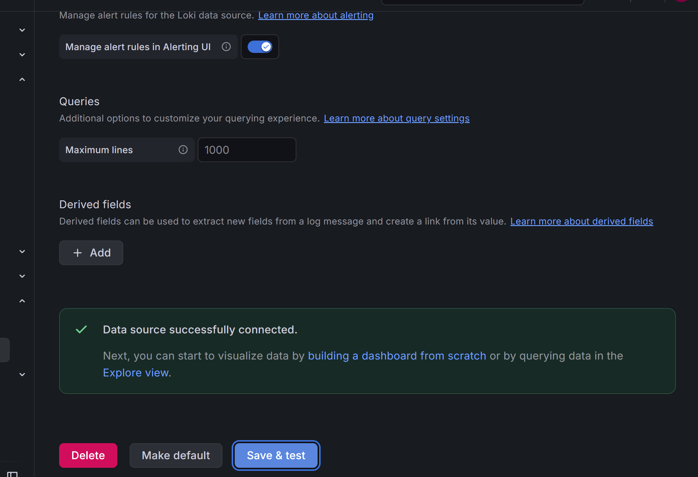

 Проверка: дёргаем /fail и ищем в логах
```
curl -v http://localhost:8000/fail
```
 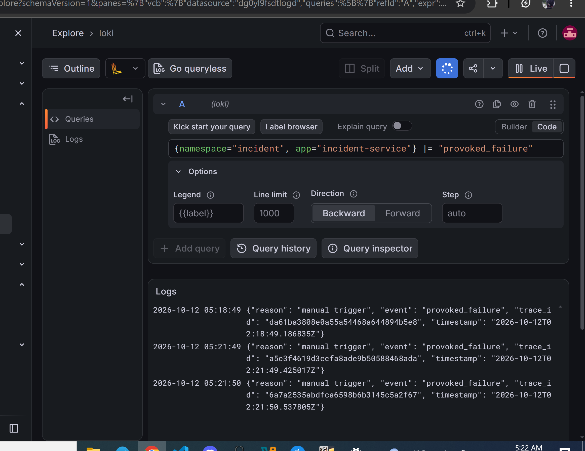
## Часть 3 — Трейсы (OpenTelemetry + Jaeger)

Трейс — это путь одного запроса через сервис (а в больших системах — через всю цепочку сервисов), собранный из отрезков-спанов. У каждого спана есть имя, начало, конец и длительность, а вложенные спаны показывают, из чего сложилось общее время. Трейсинг отвечает на вопрос «на каком шаге ушло время», когда по метрикам видно «где-то медленно», а где именно — непонятно.

Инструментируй сервис через OpenTelemetry: подключается готовая библиотека, которая на каждый входящий запрос сама создаёт корневой спан. В обработчике `/slow` оберни медленную операцию в отдельный вложенный спан (например, `slow-op`), чтобы в водопаде было видно, что время ушло именно туда. В обработчике `/fail` помечай спан как ошибочный (status = error) — Jaeger подсветит его красным. В каждый лог проставляй `trace_id` текущего спана: так строка лога и трейс связываются, и от лога можно перейти к трейсу.

Подними Jaeger (проще всего all-in-one) и направь на него OTLP-экспортёр сервиса (адрес обычно задаётся переменной `OTEL_EXPORTER_OTLP_ENDPOINT`). В Jaeger UI выбери свой сервис и найди: трейс запроса `/slow` — в водопаде виден длинный вложенный спан; трейс `/fail` — с красным ошибочным спаном. Возьми `trace_id` из лога в Grafana и найди по нему тот же трейс в Jaeger.


```
kubectl set env deployment/incident-service -n incident \
  JAEGER_ENDPOINT="http://jaeger-jaeger-operator-jaeger-collector.tracing.svc.cluster.local:4317"
```
```
kubectl port-forward -n tracing svc/jaeger-jaeger-operator-jaeger-query 16686:16686
```
```
curl http://localhost:8000/fail

```
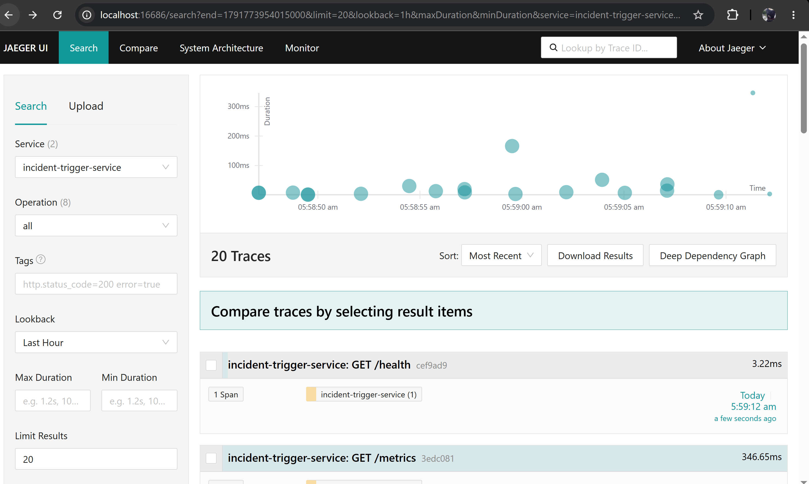
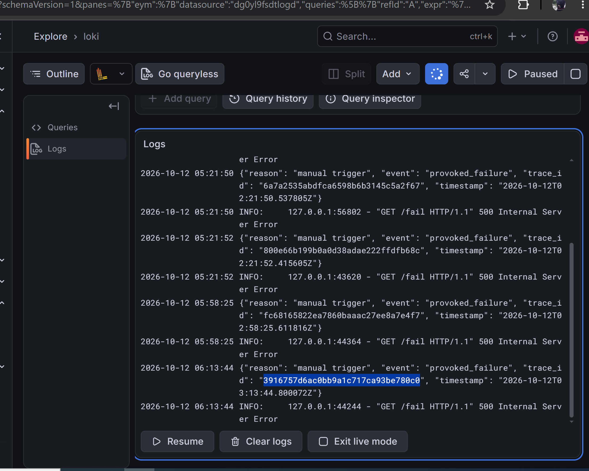
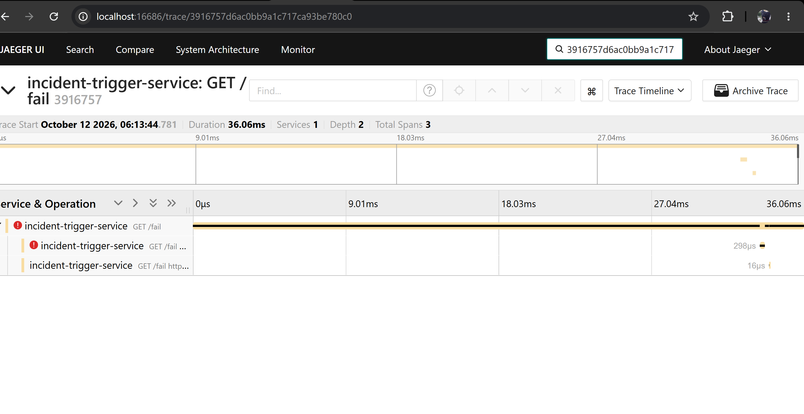
## Часть 4 — Алерты (Alertmanager + Karma)

Опиши правила алертов в Prometheus на PromQL и подключи к нему Alertmanager — компонент, который принимает сработавшие алерты, группирует их и рассылает получателям. Настрой хотя бы одного получателя (webhook, почта, Slack — что удобно, лишь бы срабатывание было видно).

Придумай 3 **действительно критичных** алерта — такие, по которым на настоящем проекте пришлось бы реально среагировать, а не просто «загорелся жёлтый график». Отталкивайся от боли пользователя и здоровья сервиса: например, доля ошибок выше порога несколько минут подряд; p95 времени ответа выше допустимого; сервис не отвечает вовсе. Для каждого объясни в отчёте, что он ловит, почему это важно и что по нему делать дежурному. Спровоцируй срабатывания кнопками (`/fail`, `/load`, `/slow`) и покажи алерты в состоянии firing.

Поверх Alertmanager подними Karma — веб-дашборд, который показывает все активные алерты в одном окне, с группировкой и фильтрами. Штатный интерфейс Alertmanager для этого бедноват, а Karma удобна, когда алертов становится много и за ними надо наблюдать вживую. Посмотри свои сработавшие алерты в Karma.

Правила описываются в кастомном ресурсе PrometheusRule (CRD от Prometheus Operator, который уже стоит у вас в составе kube-prometheus-stack). Prometheus сам подхватывает такие объекты по лейблу release.

Настройка alertmanager


Применим alert-rules.yaml к prometheus
```
kubectl apply -f alert-rules.yaml
```
Проверим, что prometheus подхватил правила
```
kubectl get prometheusrules -n monitoring
```
**Алерт 1. Доля ошибок 5xx выше 5% несколько минут подряд**
Что ловит: устойчивый рост доли серверных ошибок. Пользователи прямо сейчас получают 500-е.

Почему критично: это прямая деградация пользовательского опыта. Даже если RPS небольшой, 10% ошибок означает, что каждый десятый запрос ломается. Кратковременный всплеск (одна-две секунды) можно игнорировать, но если ошибки держатся 5 минут — это уже инцидент.
```
- alert: HighErrorRate
  expr: |
    (
      sum(rate(http_requests_total{job="incident-service", status_code=~"5.."}[5m]))
      /
      sum(rate(http_requests_total{job="incident-service"}[5m]))
    ) > 0.05
  for: 5m
  labels:
    severity: critical
  annotations:
    summary: "Доля 5xx ошибок выше 5% ({{ $value | humanizePercentage }})"
    description: "Сервис incident-trigger-service отдаёт 5xx более 5% запросов последние 5 минут."
```
**Алерт 2. p95 времени ответа выше 2 секунд**
Что ловит: замедление сервиса, из-за которого пользователи ждут слишком долго. Не «немного медленнее», а именно неприемлемо долго.

Почему критично: latency — это то, что пользователь чувствует напрямую. p95 = 2 сек означает, что каждый двадцатый запрос идёт дольше двух секунд. Для интерактивного сервиса это плохо. Если ещё растёт, скоро упрётесь в таймауты клиентов и вышестоящих прокси.
```
- alert: HighLatencyP95
  expr: |
    histogram_quantile(0.95,
      sum(rate(http_request_duration_seconds_bucket{job="incident-service"}[5m])) by (le)
    ) > 2
  for: 5m
  labels:
    severity: critical
  annotations:
    summary: "p95 времени ответа выше 2 секунд ({{ $value }}s)"
    description: "95-й перцентиль времени ответа incident-trigger-service превышает 2 секунды последние 5 минут."
```
**Алерт 3. Сервис не отвечает вовсе (метрики пропали)**
Что ловит: сервис полностью недоступен. Prometheus не может снять метрики с таргета.

Почему критично: это самый тяжёлый тип инцидента. Пользователи вообще ничего не получают. При этом дашборды могут быть пустыми — потому что данных просто нет. Нужен отдельный алерт именно на «отсутствие данных», а не на «плохие данные».
```
- alert: ServiceDown
  expr: up{job="incident-service"} == 0
  for: 2m
  labels:
    severity: critical
  annotations:
    summary: "Сервис incident-trigger-service недоступен"
    description: "Prometheus не может снять метрики с incident-service более 2 минут."
```
Karma — это веб-интерфейс поверх Alertmanager. Он агрегирует алерты из нескольких Alertmanager, дедуплицирует, группирует и даёт удобные фильтры. Штатный UI Alertmanager для этого бедноват, особенно когда алертов много.

Установка через Helm

```
helm repo add wiremind https://wiremind.github.io/wiremind-helm-charts
helm repo update
```
уточняем имя сервиса Alertmanager
```
kubectl get svc -n monitoring | grep alertmanager
```
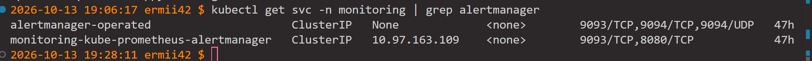
```
helm install karma wiremind/karma -n monitoring \
  --set config.alertmanager.servers[0].name=monitoring \
  --set config.alertmanager.servers[0].uri=http://monitoring-kube-prometheus-alertmanager.monitoring.svc.cluster.local:9093
```

Проверка
```
kubectl get pods -n monitoring -l app.kubernetes.io/name=karma
kubectl port-forward -n monitoring svc/karma 8081:80 --address 0.0.0.0
```

**Провоцируем HighErrorRate**
```
# Порт-форвард на сервис
kubectl port-forward -n incident svc/incident-service 8000:8000 --address 0.0.0.0

# Дёргаем /fail в цикле — чтобы доля ошибок превысила 5%
curl -X GET "http://localhost:8000/load?target=/fail&total=1000&concurrent=50"
```
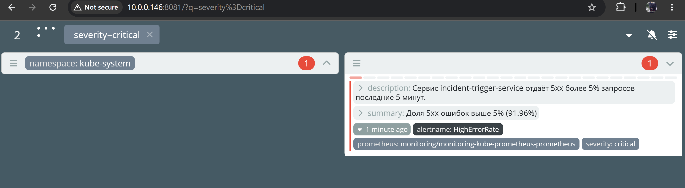

**Провоцируем HighLatencyP95**
```
curl -X GET "http://localhost:8000/load?target=/slow&total=300&concurrent=20"
```
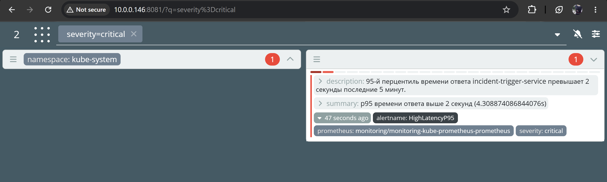

**Провоцируем ServiceDown**
```
kubectl scale deployment incident-service --replicas=0 -n incident
```
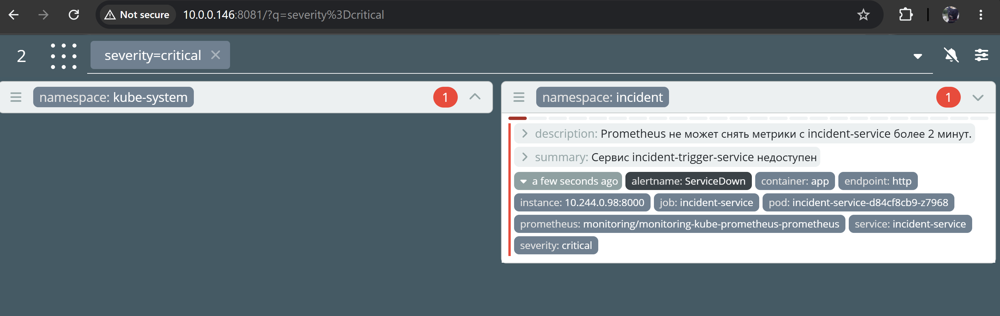