## Часть 0 — Сервисы

Сгенерируем `api` и `worker`:

- `api` — HTTP-сервис с эндпоинтами:
  - `GET /health` — возвращает `ok`, но при выставленной переменной окружения (например, `HEALTH_FAIL=true`) отвечает 5xx — понадобится в Части 2;
  - `POST /order` — пишет заказ в `postgres`;
  - `GET /orders` — читает и отдаёт список заказов;
- `worker` — читает заказы из `postgres` и помечает обработанными.

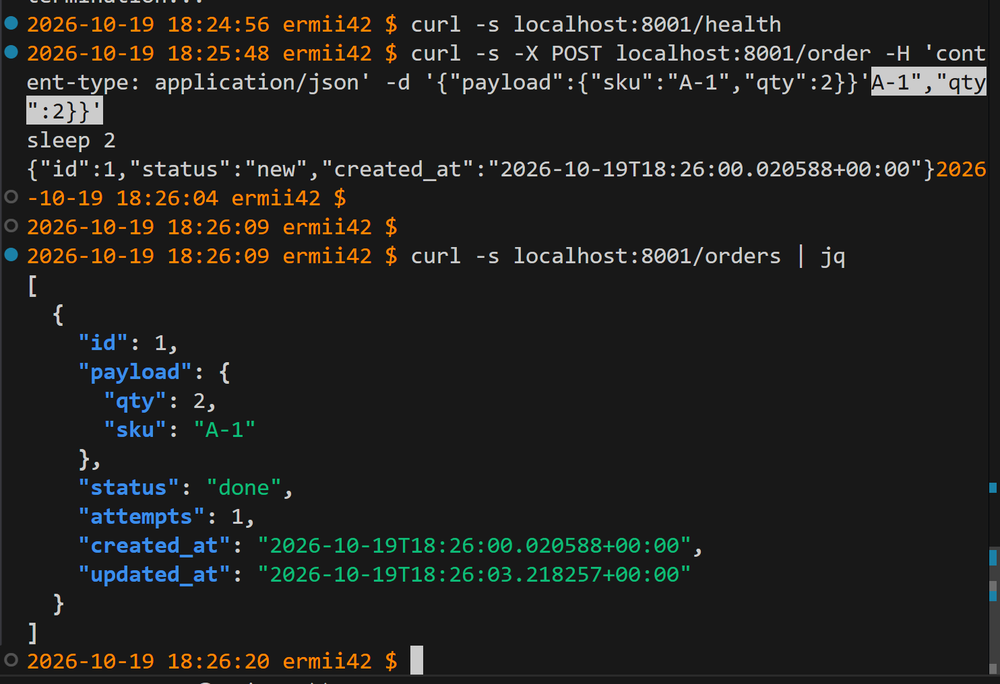

## Часть 1 — Ограждения на кластер

Для локального кластера было принято решение выбирать Kyverno.
1. Достаточная выразительность для заявленных правил. Все пять требований (лимиты, доверенный реестр, метки, запрет privileged, запрет hostPath) покрываются штатными Kyverno-политиками, в том числе в CEL-синтаксисе . Gatekeeper тоже справится, но выигрыша в этих сценариях не даст.
2. Встроенный аудит и drift-обнаружение. Kyverno умеет фоново проверять уже существующие ресурсы и сообщать о нарушениях, а не только блокировать новые. Для локальной демонстрации «политика работает» это удобно: можно применить манифест в audit-режиме и увидеть отчёт, не ломая кластер .
3. Меньше операционных компонентов. Kyverno — один контроллер + admission webhook. Gatekeeper — это constraint templates + constraints + сам Gatekeeper, а для продвинутых сценариев часто добавляют Ratify. Для локального кластера и 5 правил лишние движущиеся части не оправданы .

Установка Kyverno
```
helm repo add kyverno https://kyverno.github.io/kyverno/
helm repo update
helm install kyverno kyverno/kyverno -n kyverno --create-namespace
kubectl get pods -n kyverno
```

Опишем 5 политик на кластер
1. require-resource-limits.yaml — обязательные лимиты ресурсов
Польза: без limits под может выесть всю память/CPU узла и уронить соседей. Политика заставляет разработчиков явно указывать потолки.
2. restrict-src/image-registries.yaml — только доверенный реестр
Польза: образы из неизвестных публичных реестров не проходили сканирование и могут содержать вредоносный код. Политика разрешает только registry.example.com/ (замените на свой реестр) .
3. require-labels.yaml — обязательные метки
Польза: без стандартных меток (app.kubernetes.io/name) невозможно нормально фильтровать ресурсы, строить дашборды, применять NetworkPolicy и считать стоимость. Политика требует непустую метку app.kubernetes.io/name .
4. disallow-privileged.yaml — запрет privileged-контейнеров
Польза: privileged-контейнер имеет почти полный доступ к хосту и является классическим вектором container escape. Политика требует, чтобы securityContext.privileged был false или отсутствовал .
5. disallow-latest-tag.yaml — запрет тега :latest
Польза: :latest делает деплой невоспроизводимым — один и тот же манифест в разное время тянет разные образы. Политика требует явный тег (или digest), отличный от latest.

Применим их
```
helm install my-policies ./kyverno-policies
```
Убедимся, что они готовы
```
kubectl get clusterpolicy
```


Подготовим 5 сырых манифестов (см  ./bad-manifests) и проверим наши политики.
```
kubectl apply -f ./bad-manifests/bad-no-limits.yaml
kubectl apply -f ./bad-manifests/bad-image-registry.yaml
kubectl apply -f ./bad-manifests/bad-no-label.yaml
kubectl apply -f ./bad-manifests/bad-privileged.yaml
kubectl apply -f ./bad-manifests/bad-latest-tag.yaml
```


## Часть 2 — Чарт api и worker

Напиши `Chart.yaml`, `values.yaml` и шаблоны `Deployment`/`Service` для `api` (реплики — из `values`, по умолчанию 3) и `worker` (по умолчанию 2), с readiness- и liveness-пробами на `/health`. Сразу заложи в шаблоны то, что требуют правила из Части 1.

Проверим прохождение всех правил из части 1
```
helm template orders ./orders-chart > /tmp/rendered.yaml
kubectl apply --dry-run=server -f /tmp/rendered.yaml
```

```
helm lint ./orders-chart
```

Установим чарт
```
helm upgrade --install orders ./orders-chart \
  -n orders --create-namespace \
```


Проверим на своём чарте reconciliation:

- удалим под `api` руками
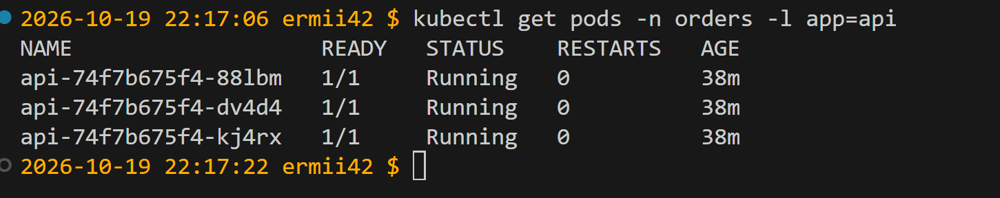

 он вернулся;
 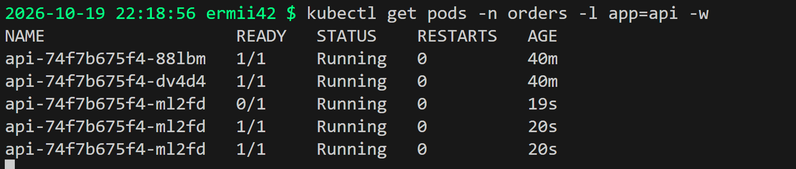
 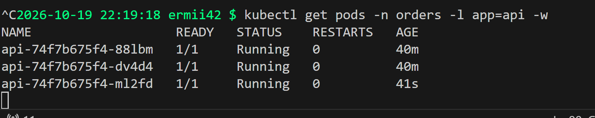
- поменяем `replicas` в `values.yaml`, сделаем`helm upgrade` → число подов догнало новое значение.
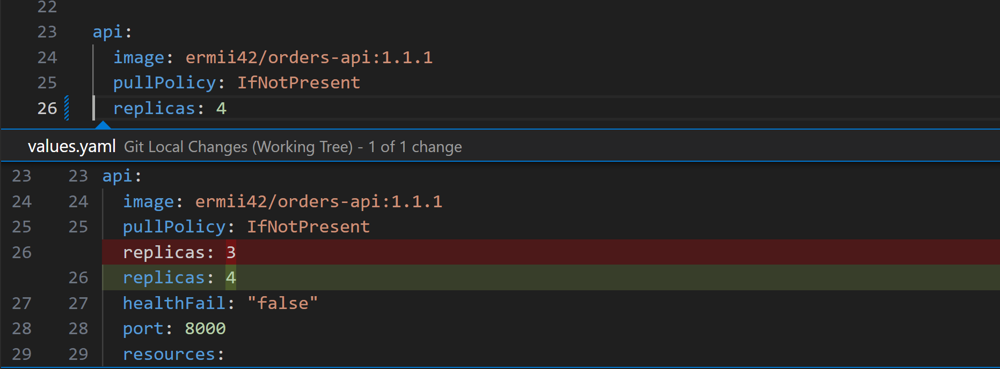
```
helm upgrade orders ./orders-chart -n orders
```
смотреть, как догоняет
```
kubectl get deploy api -n orders -w
```

Теперь настоящий rolling update. Подними версию образа `api` в `values.yaml` и сделай `helm upgrade`, одновременно долбя `/health` в цикле — убедись, что ни один запрос не провалился, а поды обновляются по одному, а не все разом.

HEALTH_FAIL=false (иначе поды будут NotReady и rolling update застрянет):
```
kubectl set env deploy/api -n orders HEALTH_FAIL=false
```
Добавим в api-deployment.yaml
```
  strategy:
    type: RollingUpdate
    rollingUpdate:
      maxSurge: 1
      maxUnavailable: 0
```
maxSurge: 1 — это максимальное количество подов, которое можно создать сверх желаемого числа replicas во время rolling update.
maxUnavailable — это максимальное количество подов, которое может быть недоступно (не Ready) сверх желаемого числа. При replicas: 3 и maxUnavailable: 0:

минимум доступных подов = replicas - maxUnavailable = 3 - 0 = 3.

То есть в любой момент времени должно быть не меньше 3 Ready-подов.

Узнаем адрес доступа к сервису через
```
minikube service api -n orders --url
```

Подготовим «долбящий» цикл
```
# счётчик успехов/неуспехов + вывод статусов
ok=0; fail=0
while true; do
  code=$(curl -s -o /dev/null -w '%{http_code}' --max-time 3 http://192.168.39.162:30080/health)
  if [ "$code" = "200" ]; then
    ok=$((ok+1))
  else
    fail=$((fail+1))
    echo "$(date +%T) FAIL code=$code"
  fi
  printf '\r%s ok=%d fail=%d' "$(date +%T)" "$ok" "$fail"
  sleep 0.2
done
```
Заменим в values.yaml образ ermii42/orders-api:1.1.1 -> ermii42/orders-api:1.1.2 и запустим helm upgrade

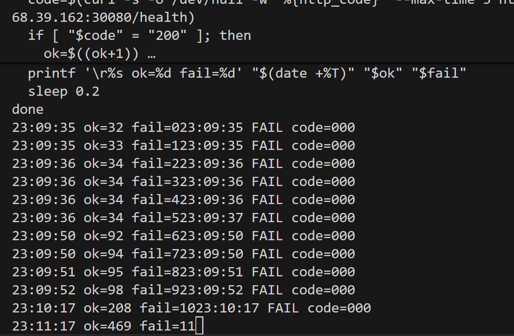
(Код 000 в curl означает, что HTTP-ответ не был получен вообще: соединение либо не установилось, либо оборвалось на транспортном уровне, а не ошибки rolling update и не падение приложения)
Rolling update отработал корректно, поды обновляются по одному, не было ситуации, когда все поды были неактивны.

Запустить «долбящий» цикл в отдельном терминале
И выкатим заведомо поломанную версию
```
helm upgrade orders ./orders-chart -n orders \
  --set api.healthFail=true
```
И мы видим 

Новый под api-<new>-ddd остаётся 0/1 Running — он запущен, процесс жив, но readinessProbe на /health возвращает 503 (потому что HEALTH_FAIL=true), поэтому под никогда не становится Ready.

Старые aaa, bbb, ccc продолжают 1/1 Running — Kubernetes не гасит их, потому что maxUnavailable: 0 запрещает уменьшать число доступных подов ниже 3, а новый под не готов.

Rollout зависает 


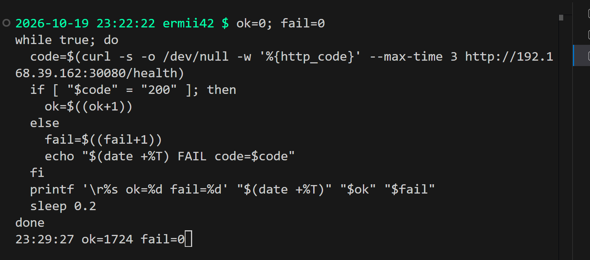
fail=0 — сервис продолжает отвечать всё это время, потому что трафик идёт на старые здоровые поды. Новый «сломанный» под в Endpoints не попадает (он NotReady), поэтому Service его не видит.

явное подтверждение, что rollout завис


сделаем откат на предыдущую версию
```
helm rollback orders -n orders
```


Теперь все хорошо :)


## Часть 3 — Postgres через оператора

Разверни оператор БД (CloudNativePG или Zalando postgres-operator) один раз на кластер. Добавь в чарт шаблон, который создаёт объект оператора (например, `Cluster` у CloudNativePG).

Установка оператора CloudNativePG
```
# Добавляем репозиторий чартов CNPG
helm repo add cnpg https://cloudnative-pg.github.io/charts
helm repo update

# Устанавливаем оператор
helm upgrade --install cnpg \
  --namespace cnpg-system \
  --create-namespace \
  cnpg/cloudnative-pg
```
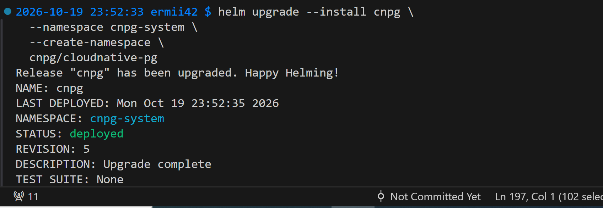
Добавление шаблона Cluster в Helm-чарт
Cоздадим файл templates/postgres-cluster.yaml (вместо deployment-postgres.yaml и service-postgres.yaml), подправим values.yaml, api-deployment.yaml, postgres-configmap.yaml и worker-deployment.yaml

Удалим под `postgres` руками и посмотрим самовосстановление.
```
kubectl delete pod -n orders orders-postgres-1
```
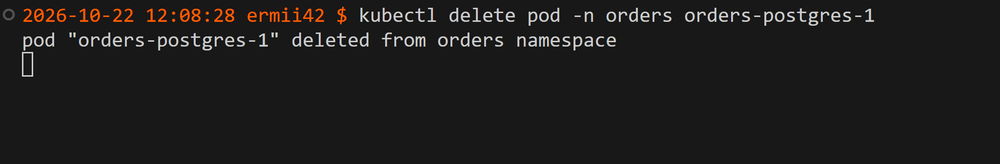
Сразу после этого начнем следить за подами:
```
kubectl get pods -n orders -w
```
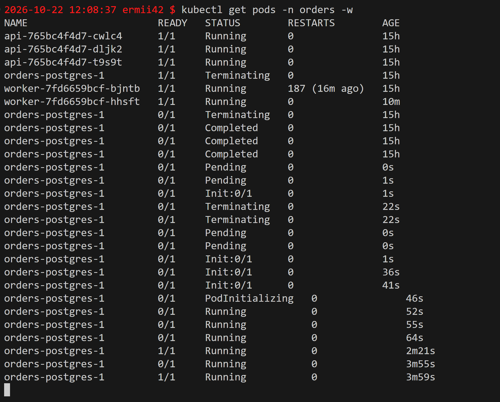
Оператор заметил, что фактическое состояние (0 подов) отличается от желаемого (1), и автоматически создал новый под. Это и есть reconciliation на уровне оператора.

Посмотрим объект, найдем в нём `spec` и `status`.
```
kubectl get cluster -n orders orders-postgres -o yaml
```
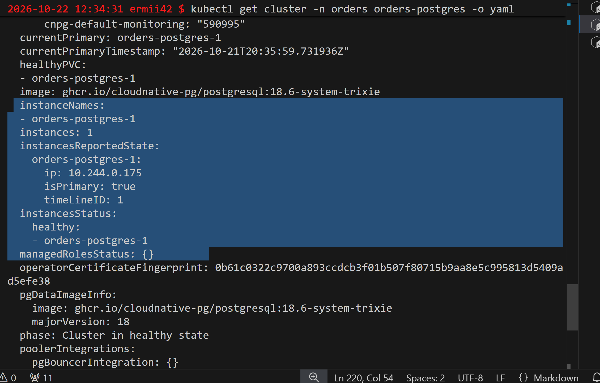

*Сравнение оператора и controller-manager*
Стандартный controller-manager — это «универсальный диспетчер», который не знает, что внутри пода. Оператор CloudNativePG — это «диспетчер, который знает, что управляет базой данных». Он использует тот же механизм reconciliation, но принимает решения на основе понимания ролей primary/replica и состояния PostgreSQL, а не просто количества запущенных подов.

## Часть 4 — Падение control plane

*Остановка компонента control plane*
В Minikube etcd и kube-apiserver запускаются как статические поды (static pods). Их манифесты лежат в директории /etc/kubernetes/manifests внутри виртуальной машины, и kubelet автоматически перезапускает их при падении.

Чтобы «сломать» control plane, нужно временно убрать манифест нужного компонента из этой директории. Например, для etcd:
Заходим внутрь minikube
```
minikube ssh
```
Перемещаем манифест etcd в /tmp (kubelet перестанет его видеть и остановит под)
```
sudo mv /etc/kubernetes/manifests/etcd.yaml /tmp/
```
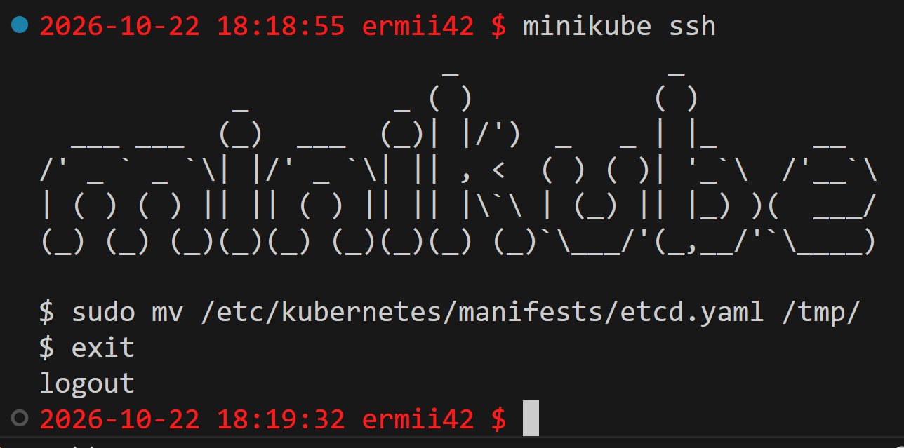
После этого kubectl перестанет отвечать на запросы.
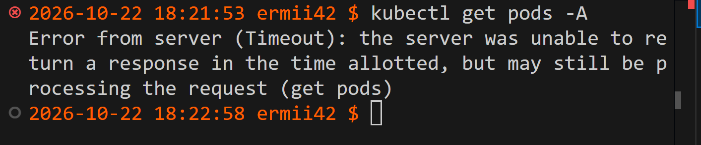
попробем что-то изменить
```
helm upgrade orders ./orders-chart -n orders
```
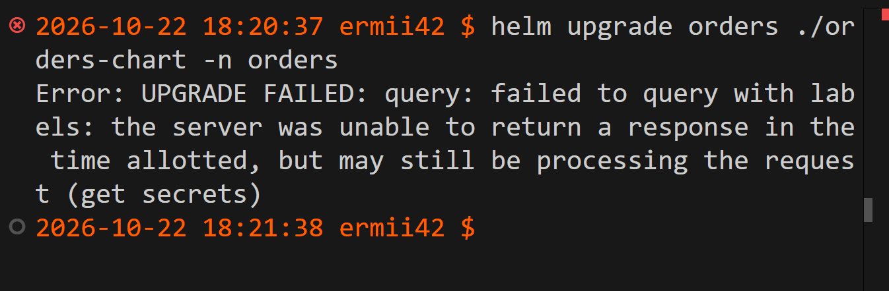
изменения не проходят

- проверим, что `api`/`worker`/`postgres` продолжают отвечать (`/health`, `/orders`).
```
curl -s http://$(minikube ip):30080/health
curl -s http://$(minikube ip):30080/orders
```
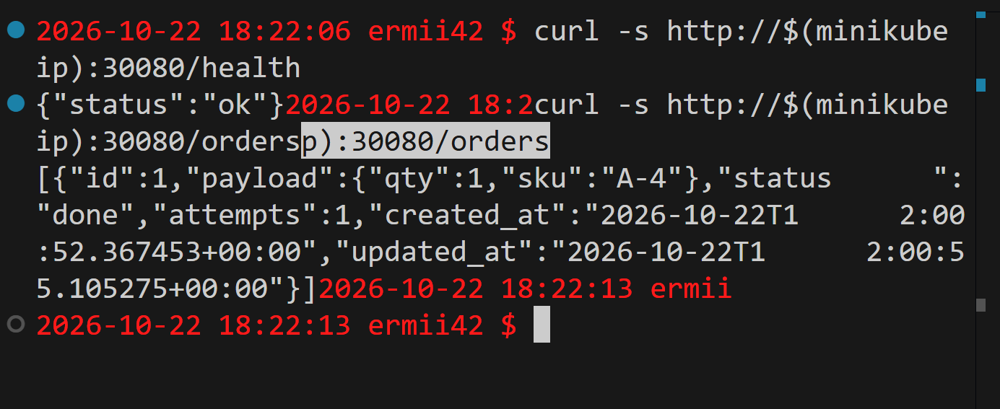

Вернем control plane и убедимся, что кластер снова управляем.

## Часть 5 — Мониторинг

У нас уже есть kube-prometheus stack из лабораторной работы 2 (запускали командой)
```
helm install prometheus prometheus-community/kube-prometheus-stack \
  --namespace monitoring \
  --create-namespace \
  --set prometheus.prometheusSpec.serviceMonitorSelectorNilUsesHelmValues=false
```
 Согласно документации, при значении --set prometheus.prometheusSpec.serviceMonitorSelectorNilUsesHelmValues=false Prometheus выбирает все ServiceMonitor в кластере, независимо от их меток. Это избавляет от необходимости проставлять метку release: prometheus в каждом манифесте.
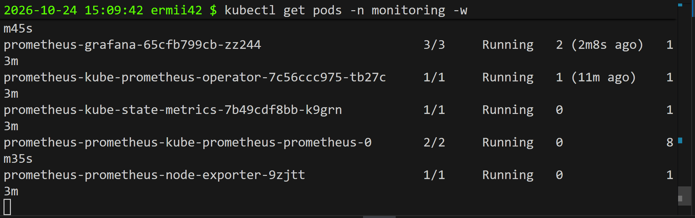

пересоберем образы приложений api и worker, чтобы они отдавали метрики на /metrics prometheus и напишем templates/servicemonitor.yaml

Опишем алерты в orders-chart/templates/prometheusrule.yaml
**OrdersApiDown**
проверяет up == 0 для target'а api
Если API недоступен, пользователи не могут создавать/читать заказы. Алерт срабатывает быстро, чтобы минимизировать downtime

**OrdersApiHighErrorRate**
Доля 5xx ошибок > 5% за 5 минут
Даже если поды Running, ошибки на /order или /orders означают, что сервис не выполняет свою функцию. Это важнее, чем «процесс жив».

**OrdersWorkerProcessingStalled**
rate(orders_processed_total) == 0 при непустой очереди или упавшем worker'е
Ловит тихую деградацию: API может отвечать 201 Created, но если worker не обрабатывает заказы, они навсегда остаются в статусе new. Пользователь не видит ошибки сразу, но бизнес-процесс сломан.

Изменим values.yaml, добавив
```
monitoring:
  enabled: true
  interval: 30s
  scrapeTimeout: 10s
```
также добавим templates/servicemonitor.yaml и применим изменения
```
helm upgrade orders ./orders-chart -n orders
```
Алерты 
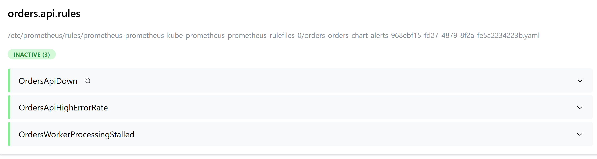

Спровоцируем состояние firing OrdersApiDown, временно изменим targetPort в Service на несуществующий порт:
```
kubectl patch svc api -n orders -p '{"spec":{"ports":[{"name":"http","port":80,"targetPort":9999}]}}'
```
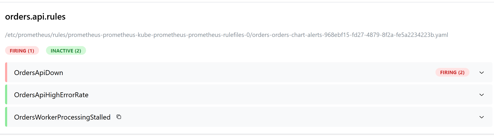
