## Часть 0 — Сервисы

Сгенерируй `api` и `worker`:

- `api` — HTTP-сервис с эндпоинтами:
  - `GET /health` — возвращает `ok`, но при выставленной переменной окружения (например, `HEALTH_FAIL=true`) отвечает 5xx — понадобится в Части 2;
  - `POST /order` — пишет заказ в `postgres`;
  - `GET /orders` — читает и отдаёт список заказов;
- `worker` — читает заказы из `postgres` и помечает обработанными.


## Часть 1 — Ограждения на кластер

Для локального кластера было принято решение выбирать Kyverno.
1. Достаточная выразительность для заявленных правил. Все пять требований (лимиты, доверенный реестр, метки, запрет privileged, запрет hostPath) покрываются штатными Kyverno-политиками, в том числе в CEL-синтаксисе . Gatekeeper тоже справится, но выигрыша в этих сценариях не даст.
2. Встроенный аудит и drift-обнаружение. Kyverno умеет фоново проверять уже существующие ресурсы и сообщать о нарушениях, а не только блокировать новые. Для локальной демонстрации «политика работает» это удобно: можно применить манифест в audit-режиме и увидеть отчёт, не ломая кластер .
3. Меньше операционных компонентов. Kyverno — один контроллер + admission webhook. Gatekeeper — это constraint templates + constraints + сам Gatekeeper, а для продвинутых сценариев часто добавляют Ratify. Для локального кластера и 5 правил лишние движущиеся части не оправданы .

Установка Kyverno
```
helm repo add kyverno https://kyverno.github.io/kyverno/
helm repo update
helm install kyverno kyverno/kyverno -n kyverno --create-namespace
kubectl get pods -n kyverno
```
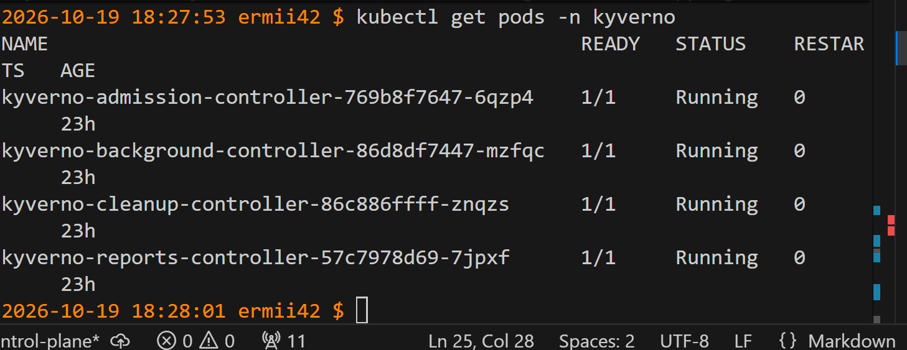
Опишем 5 политик на кластер
1. require-resource-limits.yaml — обязательные лимиты ресурсов
Польза: без limits под может выесть всю память/CPU узла и уронить соседей. Политика заставляет разработчиков явно указывать потолки.
2. restrict-image-registries.yaml — только доверенный реестр
Польза: образы из неизвестных публичных реестров не проходили сканирование и могут содержать вредоносный код. Политика разрешает только registry.example.com/ (замените на свой реестр) .
3. require-labels.yaml — обязательные метки
Польза: без стандартных меток (app.kubernetes.io/name) невозможно нормально фильтровать ресурсы, строить дашборды, применять NetworkPolicy и считать стоимость. Политика требует непустую метку app.kubernetes.io/name .
4. disallow-privileged.yaml — запрет privileged-контейнеров
Польза: privileged-контейнер имеет почти полный доступ к хосту и является классическим вектором container escape. Политика требует, чтобы securityContext.privileged был false или отсутствовал .
5. disallow-latest-tag.yaml — запрет тега :latest
Польза: :latest делает деплой невоспроизводимым — один и тот же манифест в разное время тянет разные образы. Политика требует явный тег (или digest), отличный от latest.

Применим их
```
helm install my-policies ./kyverno-policies
```
Убедимся, что они готовы
```
kubectl get clusterpolicy
```
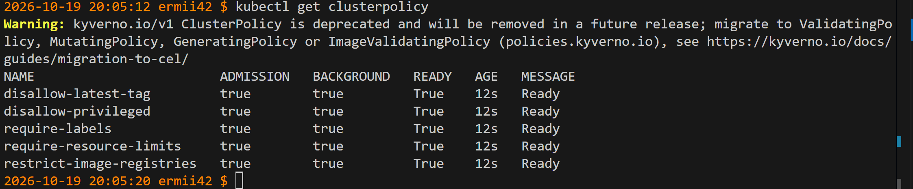

Подготовим 5 сырых манифестов (см  ./bad-manifests) и проверим наши политики.
```
kubectl apply -f ./bad-manifests/bad-no-limits.yaml
kubectl apply -f ./bad-manifests/bad-image-registry.yaml
kubectl apply -f ./bad-manifests/bad-no-label.yaml
kubectl apply -f ./bad-manifests/bad-privileged.yaml
kubectl apply -f ./bad-manifests/bad-latest-tag.yaml
```
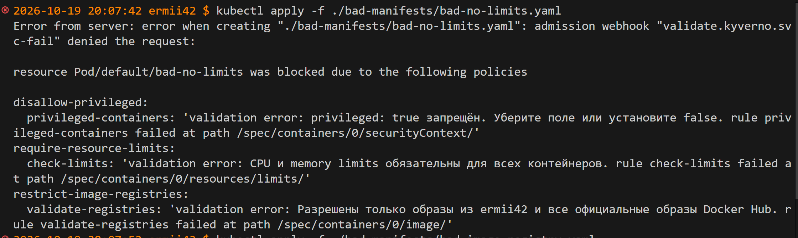
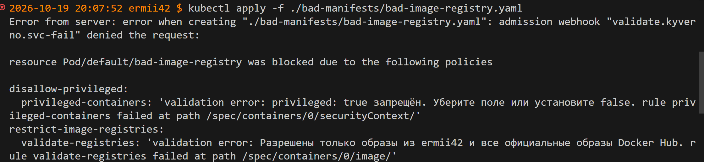
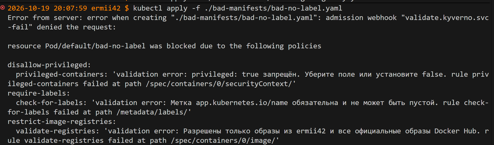
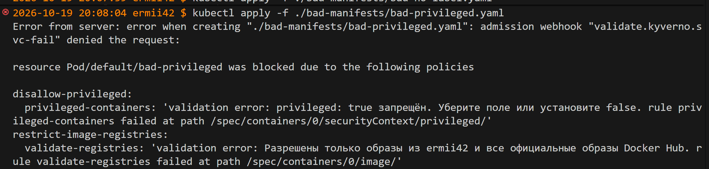
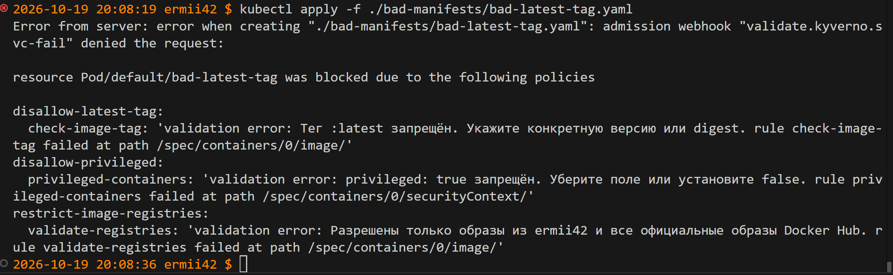
## Часть 2 — Чарт api и worker

Напиши `Chart.yaml`, `values.yaml` и шаблоны `Deployment`/`Service` для `api` (реплики — из `values`, по умолчанию 3) и `worker` (по умолчанию 2), с readiness- и liveness-пробами на `/health`. Сразу заложи в шаблоны то, что требуют правила из Части 1.

Проверим прохождение всех правил из части 1
```
helm template orders ./orders-chart > /tmp/rendered.yaml
kubectl apply --dry-run=server -f /tmp/rendered.yaml
```
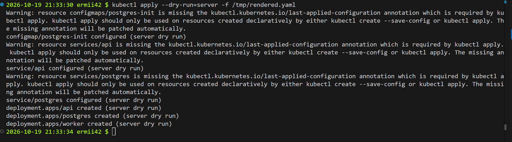
```
helm lint ./orders-chart
```
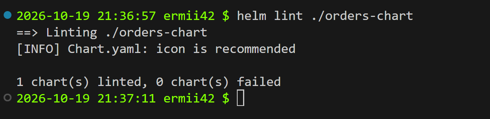
Установим чарт
```
helm upgrade --install orders ./orders-chart \
  -n orders --create-namespace \
```
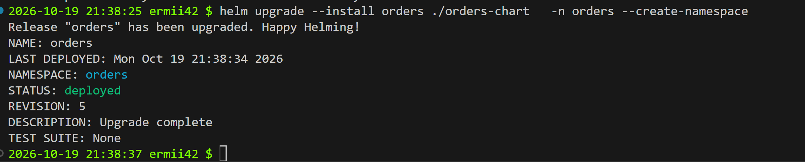

Проверим на своём чарте reconciliation:

- удалим под `api` руками


 он вернулся;
 
 
- поменяем `replicas` в `values.yaml`, сделаем`helm upgrade` → число подов догнало новое значение.

```
helm upgrade orders ./orders-chart -n orders
```
смотреть, как догоняет
```
kubectl get deploy api -n orders -w
```
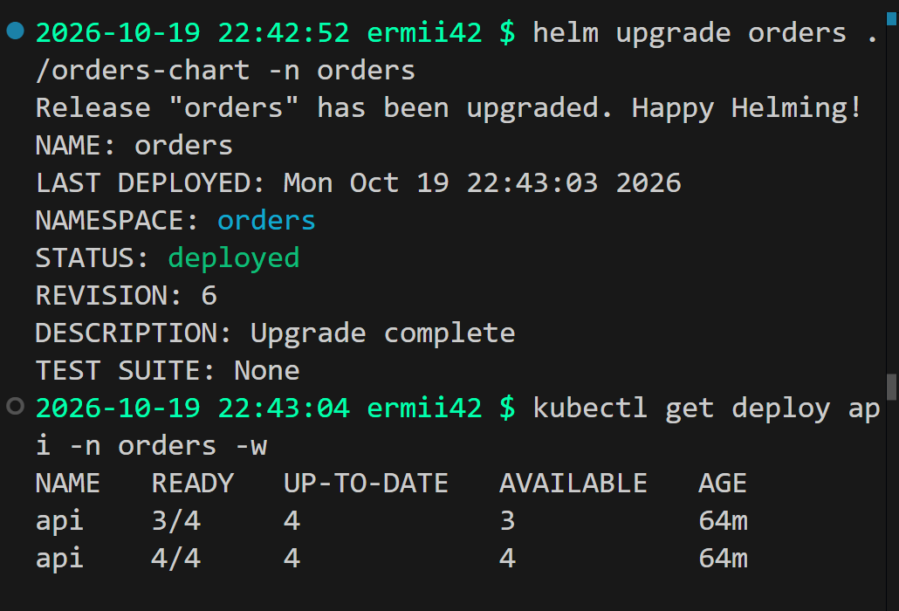
Теперь настоящий rolling update. Подними версию образа `api` в `values.yaml` и сделай `helm upgrade`, одновременно долбя `/health` в цикле — убедись, что ни один запрос не провалился, а поды обновляются по одному, а не все разом.

HEALTH_FAIL=false (иначе поды будут NotReady и rolling update застрянет):
```
kubectl set env deploy/api -n orders HEALTH_FAIL=false
```
Добавим в api-deployment.yaml
```
  strategy:
    type: RollingUpdate
    rollingUpdate:
      maxSurge: 1
      maxUnavailable: 0
```
maxSurge: 1 — это максимальное количество подов, которое можно создать сверх желаемого числа replicas во время rolling update.
maxUnavailable — это максимальное количество подов, которое может быть недоступно (не Ready) сверх желаемого числа. При replicas: 3 и maxUnavailable: 0:

минимум доступных подов = replicas - maxUnavailable = 3 - 0 = 3.

То есть в любой момент времени должно быть не меньше 3 Ready-подов.

Узнаем адрес доступа к сервису через
```
minikube service api -n orders --url
```

Подготовим «долбящий» цикл
```
# счётчик успехов/неуспехов + вывод статусов
ok=0; fail=0
while true; do
  code=$(curl -s -o /dev/null -w '%{http_code}' --max-time 3 http://192.168.39.162:30080/health)
  if [ "$code" = "200" ]; then
    ok=$((ok+1))
  else
    fail=$((fail+1))
    echo "$(date +%T) FAIL code=$code"
  fi
  printf '\r%s ok=%d fail=%d' "$(date +%T)" "$ok" "$fail"
  sleep 0.2
done
```
Заменим в values.yaml образ ermii42/orders-api:1.1.1 -> ermii42/orders-api:1.1.2 и запустим helm upgrade
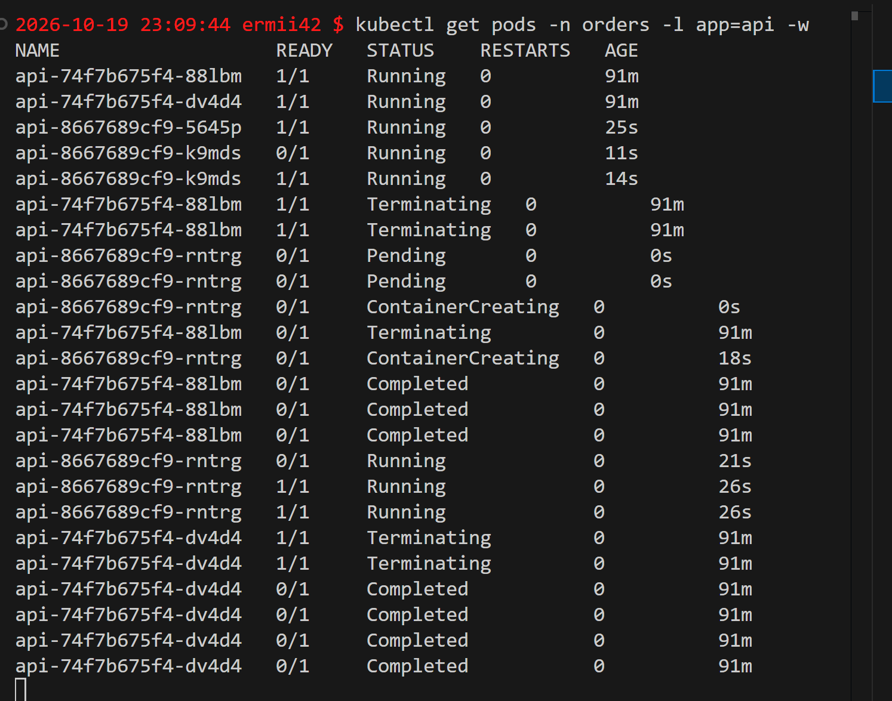

(Код 000 в curl означает, что HTTP-ответ не был получен вообще: соединение либо не установилось, либо оборвалось на транспортном уровне, а не ошибки rolling update и не падение приложения)
Rolling update отработал корректно, поды обновляются по одному, не было ситуации, когда все поды были неактивны.

Закати заведомо сломанную версию: выстави `api` переменную `HEALTH_FAIL=true` и снова сделай `helm upgrade`. Покажи, что rollout зависает — новые поды не проходят readiness, поэтому старые исправные не удаляются и сервис продолжает отвечать всё это время. Сделай `helm rollback` на предыдущую ревизию и убедись, что кластер вернулся в рабочее состояние.

Запомним текущую ревизию
```
helm history orders -n orders
```
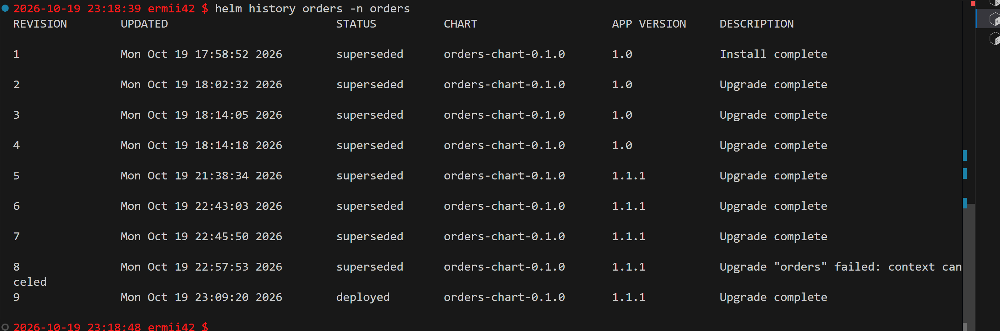
Запустить «долбящий» цикл в отдельном терминале
И выкатим заведомо поломанную версию
```
helm upgrade orders ./orders-chart -n orders \
  --set api.healthFail=true
```
И мы видим 
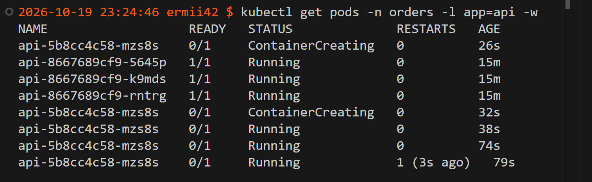
Новый под api-<new>-ddd остаётся 0/1 Running — он запущен, процесс жив, но readinessProbe на /health возвращает 503 (потому что HEALTH_FAIL=true), поэтому под никогда не становится Ready.

Старые aaa, bbb, ccc продолжают 1/1 Running — Kubernetes не гасит их, потому что maxUnavailable: 0 запрещает уменьшать число доступных подов ниже 3, а новый под не готов.

Rollout зависает 
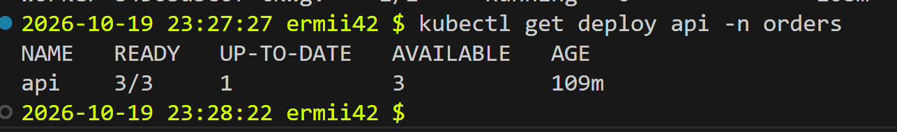


fail=0 — сервис продолжает отвечать всё это время, потому что трафик идёт на старые здоровые поды. Новый «сломанный» под в Endpoints не попадает (он NotReady), поэтому Service его не видит.

явное подтверждение, что rollout завис
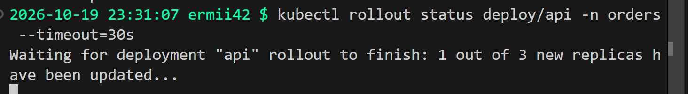

сделаем откат на предыдущую версию
```
helm rollback orders -n orders
```
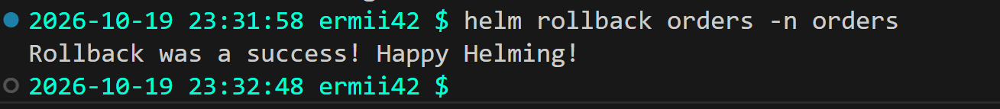

Теперь все хорошо :)
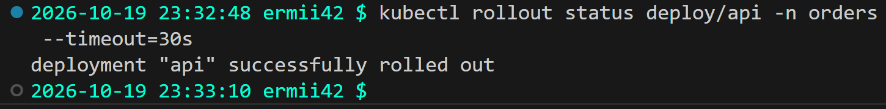
## Часть 3 — Postgres через оператора

Разверни оператор БД (CloudNativePG или Zalando postgres-operator) один раз на кластер. Добавь в чарт шаблон, который создаёт объект оператора (например, `Cluster` у CloudNativePG).

Удали под `postgres` руками → оператор вернул его. Посмотри объект (`kubectl get cluster -o yaml`), найди в нём `spec` и `status`. В README сравни, чем оператор отличается от `controller-manager`.

## Часть 4 — Падение control plane

Останови `etcd` (или `apiserver`) своего kind/k3d/minikube:

- попробуй что-то изменить (`helm upgrade`, `kubectl apply`) → изменения не проходят;
- проверь, что `api`/`worker`/`postgres` продолжают отвечать (`/health`, `/orders`).

Верни control plane и убедись, что кластер снова управляем.

## Часть 5 — Мониторинг

Добавь в чарт шаблоны `ServiceMonitor`/`PrometheusRule`, используя стек из Лабы 2 — новый не поднимай. Заложи 3 правила алертов как `PrometheusRule` в чарте, обоснуй каждое в README. Спровоцируй срабатывание хотя бы одного и покажи его в состоянии firing.
