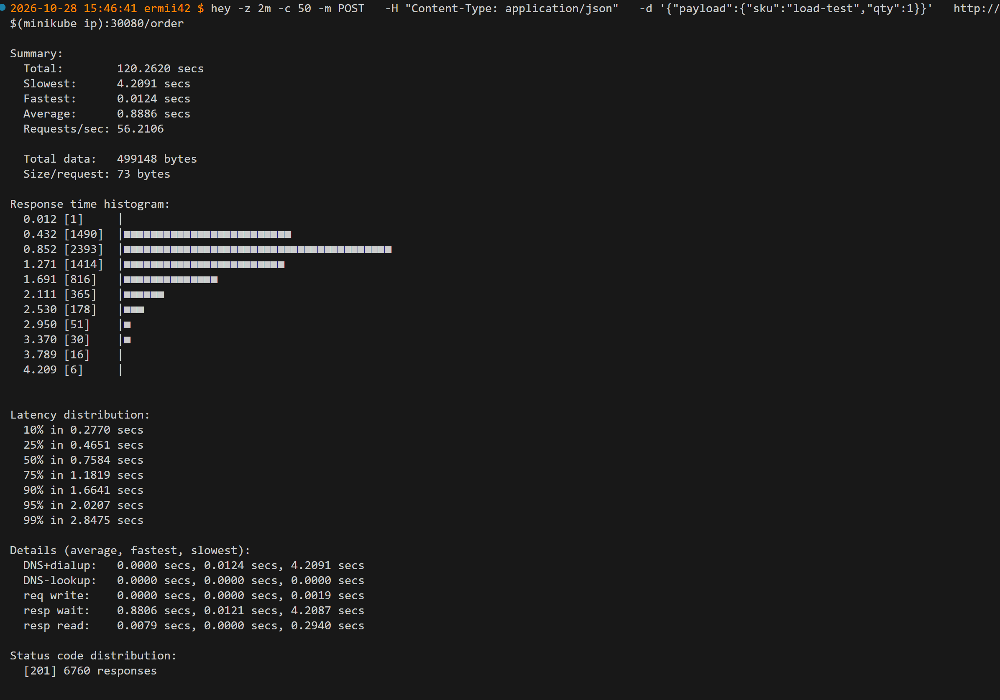

# Лаба 4 — SLA критического пути под перегрузкой

## Ситуация

В `shop` есть критический путь — оформление заказа (`api → postgres`) — и второстепенная фоновая нагрузка вроде ночной аналитики, которой под давлением можно пожертвовать. Вся настройка идёт через Helm-чарт `shop` из Лабы 3: affinity, приоритеты, ресурсы, PodDisruptionBudget — значения и шаблоны чарта, а не разовые kubectl-патчи. Руками ты только наблюдаешь и провоцируешь нагрузку.

Числа для requests/limits критического пути ты не придумываешь — их даёт `krr` (Kubernetes Resource Recommender) по реальному потреблению из Prometheus.

## Часть 0 — Сервис batch

Сборка и пуш образа
```
docker build -t ermii42/batch-analytics:0.1.0 .
docker push ermii42/batch-analytics:0.1.0
```
## Часть 1 — Выберем механизм разнесения

Добавим в values.yaml параметр scheduling.strategy, который переключает поведение между podAntiAffinity и topologySpreadConstraints. В шаблонах deployment-api.yaml и deployment-worker.yaml используем условие `{{- if eq .Values.scheduling.strategy "topologySpread" }}`, чтобы рендерить только один из блоков.

**Почему выбран topologySpreadConstraints?**

Для учебного кластера (minikube, один узел) разница не видна, но в реальном сценарии orders с 3 репликами api и 2 репликами worker:

- Гибкость при масштабировании. Если завтра api.replicas станет 5, а узлов в кластере 3, podAntiAffinity (required) оставит 2 пода в Pending навсегда. topologySpreadConstraints с maxSkew: 1 распределит 2-2-1 и продолжит работать .

- Контроль перекоса. maxSkew: 1 даёт измеримую гарантию: разница между узлами не больше одного пода. podAntiAffinity такой гарантии не даёт — при preferred поды могут «свалиться» на один узел .

- Мягкий режим ScheduleAnyway. Для учебного кластера с одним узлом DoNotSchedule заблокировал бы все поды, кроме первого. ScheduleAnyway позволяет подам запуститься даже при невозможности идеального распределения . В production можно переключить на DoNotSchedule через values.yaml, не меняя шаблоны.

podAntiAffinity оставлен как альтернатива для сценариев, где нужен строгий запрет совместного размещения (например, «два пода БД никогда не должны быть на одном узле»).

## Часть 2 — Тесная площадка

Добавим в values.yaml блок batch, а также templates/batch-service.yaml и templates/batch-deployment.yaml


## Часть 3 — Реальные числа вместо угадывания

Прогоним `hey` по пути заказа, дадим Prometheus насобирать данные.
```
hey -z 2m -c 50 -m POST   -H "Content-Type: application/json"   -d '{"payload"
:{"sku":"load-test","qty":1}}'   http://$(minikube ip):30080/order
```

Запустим `krr` против своего namespace — он проанализирует реальное потребление `api`, `worker`, `postgres`. 
```
krr simple -n orders -p http://127.0.0.1:9090
```

ограничение: krr не анализирует CNPG Cluster, только стандартные workload'ы

**Что говорит KRR:**
- requests.cpu с 100m → 57m (на под). Суммарно по 3 подам: 300m → 171m, экономия 129m.
- limits.cpu с 500m → unset (KRR считает CPU limit вредным: под должен мочь «бурстить» на свободные CPU узла).
- requests.memory с 128Mi → 100Mi (max + 15%).
- limits.memory с 256Mi → 100Mi (KRR ставит limit = request, чтобы под не мог выйти за пределы, но и не «резервировал» лишнего).

Почему так: под нагрузкой 50 RPS api реально потребляет ~57m CPU (95-й перцентиль) и ~87Mi memory (max). Наши 100m/128Mi были завышены примерно в 1.5–2 раза.

Пропишем рекомендованные значения в `values.yaml`, задеплоим через `helm upgrade`.
## Часть 4 — Разнесем критический сервис

Примени механизм из Части 1 к `api`. Докажи (`kubectl get pods -o wide`), что реплики оказались на разных нодах. Опиши в README, как это повышает отказоустойчивость.

Для начала пересоздадим кластер с несколькими нодами:
```
minikube delete

minikube start --driver=docker --cpus=5 --memory=12288 --disk-size=40g --nodes=2
```

Восстановим заново поды
```
helm install prometheus prometheus-community/kube-prometheus-stack \
  --namespace monitoring \
  --create-namespace \
  --set prometheus.prometheusSpec.serviceMonitorSelectorNilUsesHelmValues=false

helm install cnpg cnpg/cloudnative-pg \
  --namespace cnpg-system \
  --create-namespace

helm uninstall orders -n orders

helm install orders ./orders-chart -n orders --create-namespace
```

Minikube по умолчанию создаёт кластер с одной нодой. В такой конфигурации планировщик Kubernetes физически не может разместить реплики на разных нодах, даже если в манифесте заданы topologySpreadConstraints или podAntiAffinity. Для демонстрации распределения кластер был пересоздан с флагом --nodes=2

**Как это повышает отказоустойчивость**
Размещение реплик api на разных нодах означает, что при отказе одной ноды (например, minikube-m02) её поды становятся недоступны, но остальные реплики на других нодах продолжают обслуживать трафик. Kubernetes Service автоматически исключает IP недоступных подов из Endpoints, и запросы идут на живые реплики. Без такого распределения (все поды на одной ноде) отказ единственной ноды привёл бы к полной недоступности сервиса, несмотря на наличие трёх реплик
## Часть 5 — Приоритеты и гарантии

Добавим в чарт шаблоны `priorityClass` и `PodDisruptionBudget`, значения — через `values.yaml`:

- `api`, `postgres` — QoS Guaranteed на числах из Части 3 (requests = limits), высокий priorityClass, PodDisruptionBudget;
- `batch` — QoS Burstable (requests заметно ниже limits), низкий priorityClass. Лимиты у него есть, как и требуют гвардрейлы, — просто по приоритету и классу он менее защищён.

Проверим
```
# PriorityClass созданы
kubectl get priorityclass | grep orders

# PDB созданы
kubectl get pdb -n orders

# QoS классы подов
kubectl get pods -n orders -o jsonpath='{range .items[*]}{.metadata.name}{"\t"}{.status.qosClass}{"\n"}{end}'

# PriorityClass подов
kubectl get pods -n orders -o jsonpath='{range .items[*]}{.metadata.name}{"\t"}{.spec.priorityClassName}{"\n"}{end}'
```


**Что даёт каждая настройка и порядок вытеснения?**

**PriorityClass**
| Класс           | Значение | Кто           | Что даёт под давлением                                                                                          |
|-----------------|----------|---------------|-----------------------------------------------------------------------------------------------------------------|
| orders-critical | 1000000  | api, postgres | Планировщик ставит их в начало очереди; при нехватке места вытесняет поды с меньшим приоритетом (в т.ч. batch)  |
| orders-batch    | -100     | batch         | Планируется последним; при нехватке ресурсов вытесняется первым среди ваших workload'ов                         |

Что это даёт: под давлением на узле (нехватка CPU/RAM) kubelet сначала убивает поды с низким QoS, но планировщик при нехватке места для нового пода api может вытеснить batch по PriorityClass, даже если у batch ещё есть запас по request. Это гарантирует, что критичный api получит место ценой фоновой аналитики.

**PodDisruptionBudget**
| PDB             | minAvailable | Что защищает                                                                                                                                                     | Что даёт под давлением                                                                                          |
|-----------------|--------------|------------------------------------------------------------------------------------------------------------------------------------------------------------------|-----------------------------------------------------------------------------------------------------------------|
| api             | 2 (из 3)     | При kubectl drain или обновлении узла Kubernetes не даст выгнать больше одного пода api одновременно — сервис сохранит минимум 2/3 ёмкости                       | Планировщик ставит их в начало очереди; при нехватке места вытесняет поды с меньшим приоритетом (в т.ч. batch)  |
| orders-postgres | 1 (из 1)     | При instances: 1 drain узла с Postgres заблокируется — вы должны сами решить, когда переезжать БД (или увеличить instances до 2+, чтобы PDB разрешал switchover) | Планируется последним; при нехватке ресурсов вытесняется первым среди ваших workload'ов                         |

PDB защищает только от добровольных нарушений (drain, обновления, descheduler). При падении узла PDB не спасает — под просто пересоздаётся на другом узле. Поэтому PDB — дополнение к репликам, а не замена

**QoS: Guaranteed vs Burstable и порядок вытеснения**

| QoS        | Условие                                                | Кто           | Порядок вытеснения при node pressure                                                                  |
|------------|--------------------------------------------------------|---------------|-------------------------------------------------------------------------------------------------------|
| Guaranteed | requests == limits для CPU и memory у всех контейнеров | api, postgres | Последними — kubelet вытесняет их только если нет Burstable/BestEffort, превышающих request           |
| Burstable  | requests < limits (или задан только один из них)       | batch         | После BestEffort, но до Guaranteed — вытесняется, если превышает request и на узле не хватает памяти  |
| BestEffort | Нет ни requests, ни limits                             | (нет в чарте) | Первыми                                                                                               |

При нехватке памяти на узле kubelet сначала убивает batch (Burstable, если он вышел за request), и только потом трогает api/postgres (Guaranteed). Для CPU: batch с limits.cpu: 500m будет троттлиться при упоре в лимит, но не вытесняться по CPU (CPU — сжимаемый ресурс). Для memory: batch с limits.memory: 1280Mi может быть убит OOM-killer'ом при превышении лимита, но это не затронет api/postgres — у них Guaranteed, и их лимиты защищены от вытеснения по памяти.

## Часть 6 — Создадим нехватку, поймаем preemption

Подними `batch.replicas` в `values.yaml`, сделай `helm upgrade`, пока кластер не перестанет всё вмещать. Покажи и объясни:
- поды в `Pending` — кто не влез и почему (планировщик считает по requests, не по факту);
- preemption — как `api`/`postgres` (выше приоритетом) вытесняют `batch`, чтобы получить место.

**Поднимем batch.replicas и получим Pending**
Поднимем 130 реплик
## Часть 7 — Давление по памяти, порядок жертв

Через `values.yaml` подними потребление `batch`, дождись давления по памяти на ноде. Докажи, что eviction забирает `batch` первым — как менее защищённый Burstable-под с низким приоритетом, — критический путь (Guaranteed) остаётся. Объясни в README разницу с `OOMKilled` по собственному лимиту — два разных диагноза с одинаковым симптомом.

## Часть 8 — Докажи SLA под нагрузкой

Параллельно с Частями 6–7 гони `k6`/`hey` по пути заказа, снимай графики задержки и ошибок. Сформулируй свой SLA (например, «95% заказов быстрее 300 мс даже под перегрузкой») и покажи графиками, что он держится, а деградирует именно `batch`.

## Часть 9 — Мониторинг

Добавь в чарт шаблоны `ServiceMonitor`/`PrometheusRule`, используя стек из Лабы 2. Заложи 3 алерта, обоснуй каждый в README. Спровоцируй срабатывание хотя бы одного, покажи в состоянии firing.

## Результат

- реплики `api` доказуемо разнесены по нодам, даже при кластере на 1-2 ноды;
- requests/limits критического пути взяты из рекомендаций `krr`, не с потолка;
- у всех подов, включая `batch`, есть лимиты — гвардрейлы Лабы 3 без исключений;
- `Pending` и preemption под нехваткой ресурсов — увидены и объяснены;
- eviction под давлением по памяти жертвует `batch` первым за счёт QoS/приоритета, а не отсутствия лимитов;
- SLA на пути заказа держится под перегрузкой, подтверждено графиками;
- дашборд и 3 алерта поверх стека Лабы 2, встроенные в чарт.

## Что сдать

- Код `batch` с Dockerfile (реализация любая, на оценку не влияет).
- Обновлённый Helm-чарт `shop`: шаблон `batch`, `priorityClass`, `PodDisruptionBudget`, `ServiceMonitor`/`PrometheusRule`, финальный `values.yaml`.
- Отчёт `krr` (рекомендации) и сравнение с изначальной догадкой.
- `README.md`: выбор механизма разнесения (Часть 1); рекомендации `krr` vs догадка (Часть 3); доказательство разнесения (Часть 4); настройка приоритетов/QoS/PDB и разница Burstable/Guaranteed (Часть 5); что показали `Pending`/preemption (Часть 6); что показал eviction (Часть 7); SLA и графики (Часть 8); 3 алерта и обоснование (Часть 9).
- Скриншоты: реплики на разных нодах; отчёт `krr`; поды в `Pending`; момент preemption; момент eviction; графики задержки/ошибок под нагрузкой; дашборд.

## Как начать

Открой репозиторий с AI-ассистентом и попроси помочь с Лабой 4. Сгенерируй `batch` (Часть 0), дальше иди по порядку с Части 1. Ассистент ведёт по шагам и проверяет понимание, готовые политики, шаблоны чарта и рекомендации не выдаёт.

> Пользуешься AI? Проверь, что ассистент следует правилам из [`AGENTS.md`](../AGENTS.md). Большинство инструментов подхватывают его сами; если нет — укажи ему на этот файл.