# Лаба 4 — SLA критического пути под перегрузкой

## Ситуация

В `shop` есть критический путь — оформление заказа (`api → postgres`) — и второстепенная фоновая нагрузка вроде ночной аналитики, которой под давлением можно пожертвовать. Вся настройка идёт через Helm-чарт `shop` из Лабы 3: affinity, приоритеты, ресурсы, PodDisruptionBudget — значения и шаблоны чарта, а не разовые kubectl-патчи. Руками ты только наблюдаешь и провоцируешь нагрузку.

Числа для requests/limits критического пути ты не придумываешь — их даёт `krr` (Kubernetes Resource Recommender) по реальному потреблению из Prometheus.

## Часть 0 — Сервис batch

Сборка и пуш образа
```
docker build -t ermii42/batch-analytics:0.1.0 .
docker push ermii42/batch-analytics:0.1.0
```
## Часть 1 — Выберем механизм разнесения

Добавим в values.yaml параметр scheduling.strategy, который переключает поведение между podAntiAffinity и topologySpreadConstraints. В шаблонах deployment-api.yaml и deployment-worker.yaml используем условие `{{- if eq .Values.scheduling.strategy "topologySpread" }}`, чтобы рендерить только один из блоков.

**Почему выбран topologySpreadConstraints?**

Для учебного кластера (minikube, один узел) разница не видна, но в реальном сценарии orders с 3 репликами api и 2 репликами worker:

- Гибкость при масштабировании. Если завтра api.replicas станет 5, а узлов в кластере 3, podAntiAffinity (required) оставит 2 пода в Pending навсегда. topologySpreadConstraints с maxSkew: 1 распределит 2-2-1 и продолжит работать .

- Контроль перекоса. maxSkew: 1 даёт измеримую гарантию: разница между узлами не больше одного пода. podAntiAffinity такой гарантии не даёт — при preferred поды могут «свалиться» на один узел .

- Мягкий режим ScheduleAnyway. Для учебного кластера с одним узлом DoNotSchedule заблокировал бы все поды, кроме первого. ScheduleAnyway позволяет подам запуститься даже при невозможности идеального распределения . В production можно переключить на DoNotSchedule через values.yaml, не меняя шаблоны.

podAntiAffinity оставлен как альтернатива для сценариев, где нужен строгий запрет совместного размещения (например, «два пода БД никогда не должны быть на одном узле»).

## Часть 2 — Тесная площадка

Добавим в values.yaml блок batch, а также templates/batch-service.yaml и templates/batch-deployment.yaml

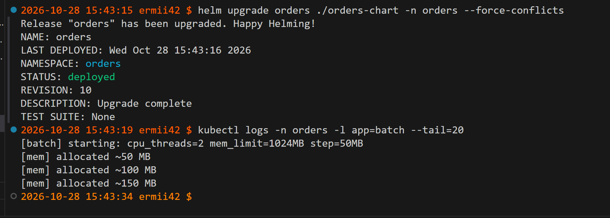

## Часть 3 — Реальные числа вместо угадывания

Прогоним `hey` по пути заказа, дадим Prometheus насобирать данные.
```
hey -z 2m -c 50 -m POST   -H "Content-Type: application/json"   -d '{"payload"
:{"sku":"load-test","qty":1}}'   http://$(minikube ip):30080/order
```

Запустим `krr` против своего namespace — он проанализирует реальное потребление `api`, `worker`, `postgres`. 
```
krr simple -n orders -p http://127.0.0.1:9090
```
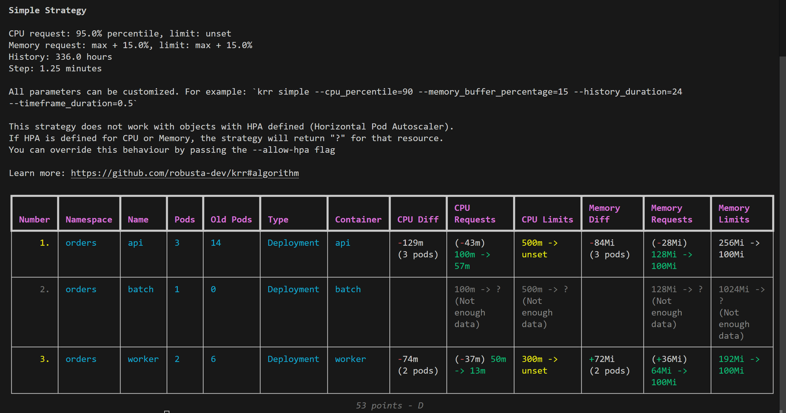
ограничение: krr не анализирует CNPG Cluster, только стандартные workload'ы

**Что говорит KRR:**
- requests.cpu с 100m → 57m (на под). Суммарно по 3 подам: 300m → 171m, экономия 129m.
- limits.cpu с 500m → unset (KRR считает CPU limit вредным: под должен мочь «бурстить» на свободные CPU узла).
- requests.memory с 128Mi → 100Mi (max + 15%).
- limits.memory с 256Mi → 100Mi (KRR ставит limit = request, чтобы под не мог выйти за пределы, но и не «резервировал» лишнего).

Почему так: под нагрузкой 50 RPS api реально потребляет ~57m CPU (95-й перцентиль) и ~87Mi memory (max). Наши 100m/128Mi были завышены примерно в 1.5–2 раза.

Пропишем рекомендованные значения в `values.yaml`, задеплоим через `helm upgrade`.
## Часть 4 — Разнесем критический сервис

Примени механизм из Части 1 к `api`. Докажем, что реплики оказались на разных нодах.

Для начала пересоздадим кластер с несколькими нодами:
```
minikube delete

minikube start --driver=docker --cpus=2 --memory=4096 --disk-size=20g --nodes=2
```
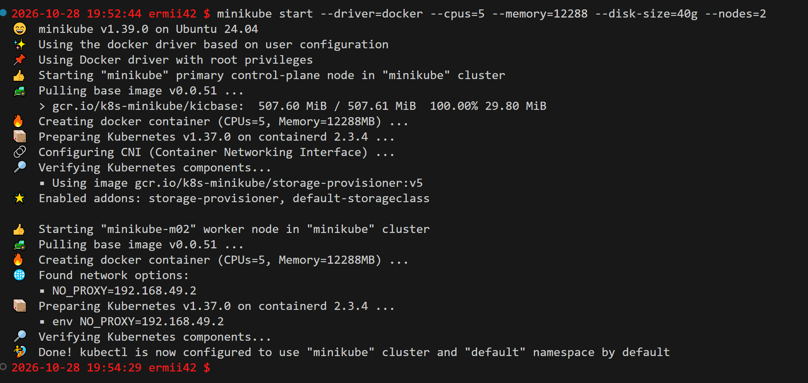
Восстановим заново поды
```
helm install prometheus prometheus-community/kube-prometheus-stack \
  --namespace monitoring \
  --create-namespace \
  --set prometheus.prometheusSpec.serviceMonitorSelectorNilUsesHelmValues=false

helm install cnpg cnpg/cloudnative-pg \
  --namespace cnpg-system \
  --create-namespace

helm uninstall orders -n orders

helm install orders ./orders-chart -n orders --create-namespace
```
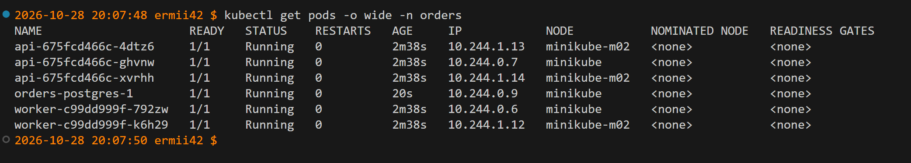
Minikube по умолчанию создаёт кластер с одной нодой. В такой конфигурации планировщик Kubernetes физически не может разместить реплики на разных нодах, даже если в манифесте заданы topologySpreadConstraints или podAntiAffinity. Для демонстрации распределения кластер был пересоздан с флагом --nodes=2

**Как это повышает отказоустойчивость**
Размещение реплик api на разных нодах означает, что при отказе одной ноды (например, minikube-m02) её поды становятся недоступны, но остальные реплики на других нодах продолжают обслуживать трафик. Kubernetes Service автоматически исключает IP недоступных подов из Endpoints, и запросы идут на живые реплики. Без такого распределения (все поды на одной ноде) отказ единственной ноды привёл бы к полной недоступности сервиса, несмотря на наличие трёх реплик
## Часть 5 — Приоритеты и гарантии

Добавим в чарт шаблоны `priorityClass` и `PodDisruptionBudget`, значения — через `values.yaml`:

- `api`, `postgres` — QoS Guaranteed на числах из Части 3 (requests = limits), высокий priorityClass, PodDisruptionBudget;
- `batch` — QoS Burstable (requests заметно ниже limits), низкий priorityClass. Лимиты у него есть, как и требуют гвардрейлы, — просто по приоритету и классу он менее защищён.

Проверим
```
# PriorityClass созданы
kubectl get priorityclass | grep orders

# PDB созданы
kubectl get pdb -n orders

# QoS классы подов
kubectl get pods -n orders -o jsonpath='{range .items[*]}{.metadata.name}{"\t"}{.status.qosClass}{"\n"}{end}'

# PriorityClass подов
kubectl get pods -n orders -o jsonpath='{range .items[*]}{.metadata.name}{"\t"}{.spec.priorityClassName}{"\n"}{end}'
```

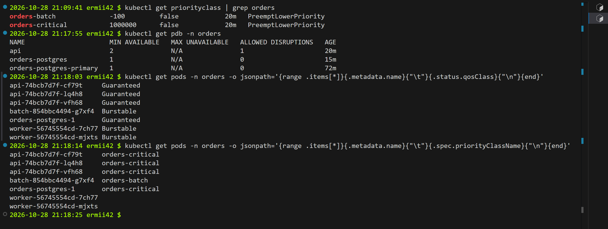


**Что даёт каждая настройка и порядок вытеснения?**

**PriorityClass**
| Класс           | Значение | Кто           | Что даёт под давлением                                                                                          |
|-----------------|----------|---------------|-----------------------------------------------------------------------------------------------------------------|
| orders-critical | 1000000  | api, postgres | Планировщик ставит их в начало очереди; при нехватке места вытесняет поды с меньшим приоритетом (в т.ч. batch)  |
| orders-batch    | -100     | batch         | Планируется последним; при нехватке ресурсов вытесняется первым среди ваших workload'ов                         |

Что это даёт: под давлением на узле (нехватка CPU/RAM) kubelet сначала убивает поды с низким QoS, но планировщик при нехватке места для нового пода api может вытеснить batch по PriorityClass, даже если у batch ещё есть запас по request. Это гарантирует, что критичный api получит место ценой фоновой аналитики.

**PodDisruptionBudget**
| PDB             | minAvailable | Что защищает                                                                                                                                                     | Что даёт под давлением                                                                                          |
|-----------------|--------------|------------------------------------------------------------------------------------------------------------------------------------------------------------------|-----------------------------------------------------------------------------------------------------------------|
| api             | 2 (из 3)     | При kubectl drain или обновлении узла Kubernetes не даст выгнать больше одного пода api одновременно — сервис сохранит минимум 2/3 ёмкости                       | Планировщик ставит их в начало очереди; при нехватке места вытесняет поды с меньшим приоритетом (в т.ч. batch)  |
| orders-postgres | 1 (из 1)     | При instances: 1 drain узла с Postgres заблокируется — вы должны сами решить, когда переезжать БД (или увеличить instances до 2+, чтобы PDB разрешал switchover) | Планируется последним; при нехватке ресурсов вытесняется первым среди ваших workload'ов                         |

PDB защищает только от добровольных нарушений (drain, обновления, descheduler). При падении узла PDB не спасает — под просто пересоздаётся на другом узле. Поэтому PDB — дополнение к репликам, а не замена

**QoS: Guaranteed vs Burstable и порядок вытеснения**

| QoS        | Условие                                                | Кто           | Порядок вытеснения при node pressure                                                                  |
|------------|--------------------------------------------------------|---------------|-------------------------------------------------------------------------------------------------------|
| Guaranteed | requests == limits для CPU и memory у всех контейнеров | api, postgres | Последними — kubelet вытесняет их только если нет Burstable/BestEffort, превышающих request           |
| Burstable  | requests < limits (или задан только один из них)       | batch         | После BestEffort, но до Guaranteed — вытесняется, если превышает request и на узле не хватает памяти  |
| BestEffort | Нет ни requests, ни limits                             | (нет в чарте) | Первыми                                                                                               |

При нехватке памяти на узле kubelet сначала убивает batch (Burstable, если он вышел за request), и только потом трогает api/postgres (Guaranteed). Для CPU: batch с limits.cpu: 500m будет троттлиться при упоре в лимит, но не вытесняться по CPU (CPU — сжимаемый ресурс). Для memory: batch с limits.memory: 1280Mi может быть убит OOM-killer'ом при превышении лимита, но это не затронет api/postgres — у них Guaranteed, и их лимиты защищены от вытеснения по памяти.

## Часть 6 — Создадим нехватку, поймаем preemption

Подними `batch.replicas` в `values.yaml`, сделай `helm upgrade`, пока кластер не перестанет всё вмещать. Покажи и объясни:
- поды в `Pending` — кто не влез и почему (планировщик считает по requests, не по факту);
- preemption — как `api`/`postgres` (выше приоритетом) вытесняют `batch`, чтобы получить место.

**Поднимем batch.replicas и получим Pending**
Поднимем 100 реплик
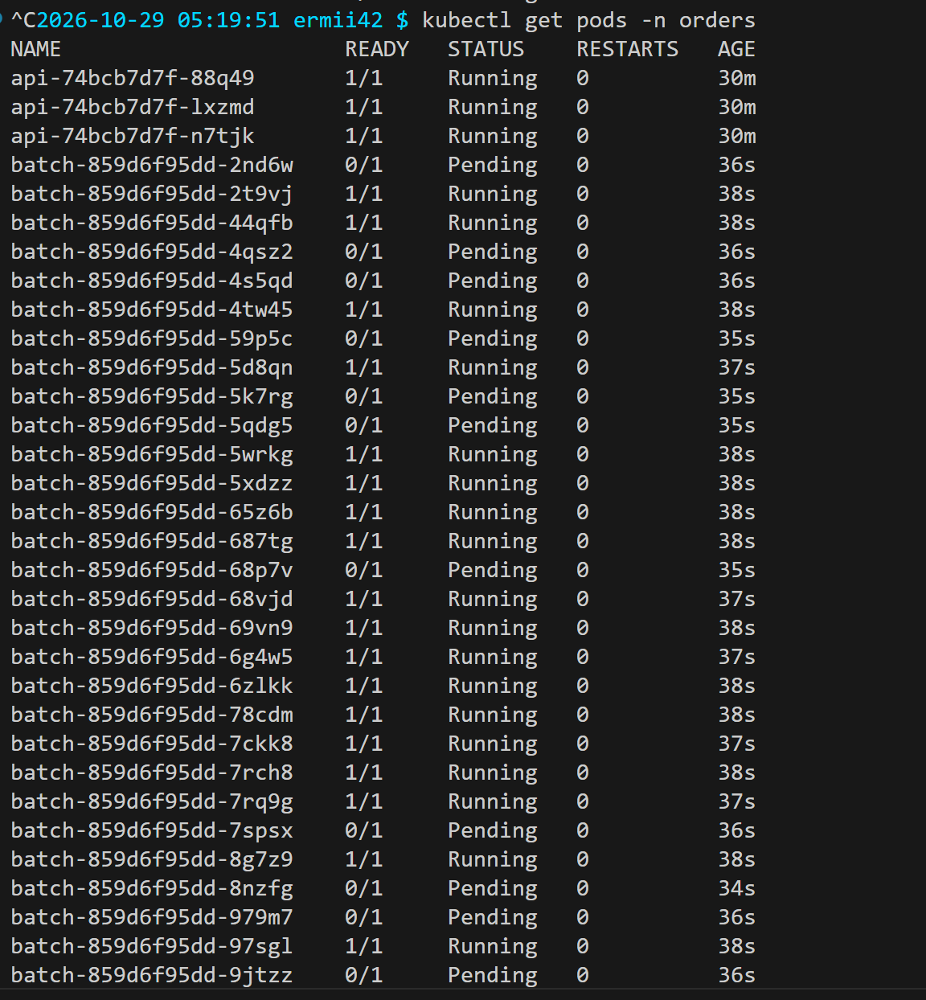
Проверим причиину
```
kubectl describe pod -n orders batch-859d6f95dd-x5cj9 | tail -20
```
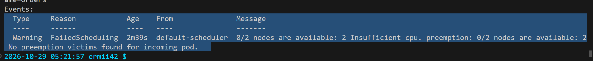
Это происходит потому, что планировщик вычитает requests каждого уже запущенного пода из Allocatable узла. Если сумма requests всех подов превышает Allocatable, новые поды не влезают 

**Провоцируем preemption (вытеснение batch)**

Теперь попробуем создать под с высоким PriorityClass и опишем его в high-priority-test.yaml
Применим его
```
kubectl apply -f high-priority-test.yaml
```
Что произойдёт: планировщик увидит, что высокоприоритетный под не влезает. Он запустит логику preemption: найдёт узел, с которого можно удалить поды с более низким приоритетом, чтобы освободить место 
Поскольку batch имеет PriorityClass orders-batch (value -100), а api/postgres — orders-critical (value 1000000), планировщик выберет batch как жертву.
**Смотрим события preemption**
```
kubectl get events -n orders --field-selector reason=Preempted --sort-by='.lastTimestamp'
```
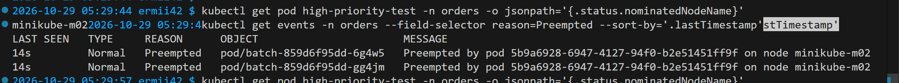
У вытесненного пода batch в событиях будет Preempted by <api-pod>. После того как batch завершит работу (или будет убит), api займёт его место.

Убедимся, что batch-поды исчезли, а тестовый под запустился
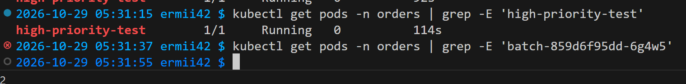

## Часть 7 — Давление по памяти, порядок жертв


Применим настройку:
```
minikube stop
    minikube start --driver=docker --cpus=2 --memory=4096 --disk-size=20g --nodes=2 --extra-config='kubelet.eviction-hard=memory.available<13Gi'
```

**Эксперимент.** Через Helm временно поднимем batch до 6 реплик, оставив лимит 1280Mi на контейнер:
```
helm upgrade orders ./orders-chart -n orders --reuse-values --set batch.replicas=6
```

```
kubectl get events -A --field-selector reason=Evicted --sort-by=.metadata.creationTimestamp
```
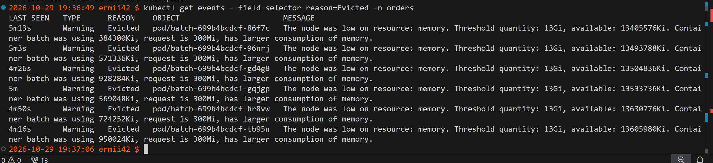
Оба узла показали MemoryPressure=True и событие EvictionThresholdMet («Attempting to reclaim memory»). В namespace orders увидел шесть событий Evicted, все относятся к batch.

У этих подов status.reason был Evicted, QoS — Burstable, PriorityClass — orders-batch (-100). В тот же момент Deployment api был 3/3 Available, все три пода api имели Ready 1/1 и QoS Guaranteed; orders-postgres-1 был Ready 1/1, CNPG показывал «Cluster in healthy state». Событий Evicted для api и PostgreSQL не было. При node pressure kubelet выбирает жертв с учётом превышения потребления над request и приоритета; batch использовал больше своих 300Mi и имел низкий приоритет. Это наблюдение подтверждает порядок жертв в данном эксперименте.

**Evicted и OOMKilled — разные диагнозы.** Evicted означает, что kubelet удалил под из-за нехватки памяти на ноде: у пода status.reason=Evicted, а в событии указаны порог memory.available и потребление контейнера. OOMKilled означает, что контейнер превысил собственный limits.memory (или был убит OOM killer) и завершился с reason=OOMKilled; под может перезапуститься. В обоих случаях приложение кратковременно исчезает, но причину проверяют по status.reason, lastState.terminated.reason и событиям. В этом прогоне зафиксирован именно eviction: потребление показанных batch-подов было ниже лимита 1280Mi.


## Часть 8 — Докажем SLA под нагрузкой

**SLA для этого опыта:** при восьми параллельных клиентах и конкуренции с шестью `batch`-репликами не менее 95% запросов `POST /order` завершаются за 300 мс, а доля HTTP 5xx равна нулю. Это проверка конкретной нагрузки и двухнодового учебного кластера, а не гарантия для любого потока запросов.

В **первом терминале** запустим нагрузку на 100 секунд:

```bash
hey -z 100s -c 8 -m POST -H 'Content-Type: application/json' \
  -d '{"payload":{"sku":"sla-pressure","qty":1}}' \
  "http://$(minikube ip):30080/order" | tee /tmp/orders-sla-pressure.txt
```

Во **втором терминале**, пока `hey` работает, увеличим фоновую нагрузку и наблюдаем за доступностью. Значение 6 только для эксперимента; в `values.yaml` остаётся штатное значение 2.

```bash
helm upgrade orders ./orders-chart -n orders --set batch.replicas=6
kubectl get deploy -n orders api batch
kubectl get events -n orders --field-selector reason=Evicted \
  --sort-by=.metadata.creationTimestamp
```

`hey` выполнил 6516 запросов за 100,08 с (65,11 запросов/с), все ответы `201`; p95 = **201,8 мс**, p99 = 298,7 мс. На пике `api` оставался **3/3 Available**, а `batch` — **1/6 Available**. В событиях появились новые `Evicted` для `batch`; например, под `batch-699b4bcdcf-xr5fl` был вытеснен при потреблении 1030928 Ki и request 300 Mi. 
Так сервис заказа выдержал заданный SLA, а фоновая нагрузка потеряла ёмкость.

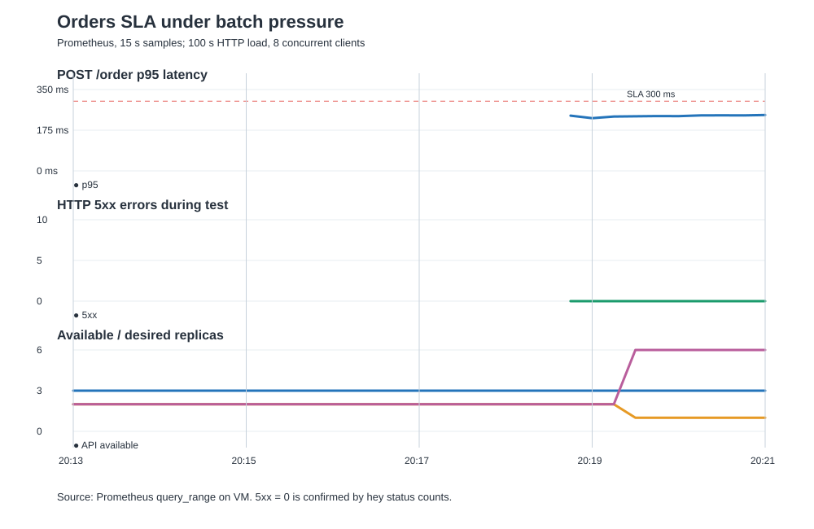

График построен из `Prometheus /api/v1/query_range` с шагом 15 секунд. У серии 5xx нет значений, потому что ошибок не было; нулевая линия подтверждена распределением кодов `hey` (6516 ответов `201`). `

После опыта восстановим штатную конфигурацию:

```bash
helm upgrade orders ./orders-chart -n orders --wait --timeout 5m
```

## Часть 9 — Мониторинг

В чарт добавлены `ServiceMonitor` для `api` и `worker`, `PrometheusRule` с тремя алертами и ConfigMap с JSON-дашбордом Grafana. Prometheus из Лабы 2 выбирает `ServiceMonitor` из namespace `orders` и правила с меткой `release: prometheus`.

В `values.yaml` указан `orders-worker:monitoring-fixed`. После пересоздания Minikube соберем образ снова перед `helm upgrade`.

| Алерт | Условие и выдержка | Зачем нужен |
|---|---|---|
| `OrdersApiUnavailable` | Ни одного доступного API target в Prometheus в течение 1 минуты | Потеря всего пути оформления заказов требует немедленной реакции. |
| `OrdersApiHighErrorRate` | Доля HTTP 5xx для `/order` выше 5% в течение 2 минут | Улавливает функциональную деградацию, даже когда поды формально Running. |
| `OrdersBatchDegraded` | Available-реплик `batch` меньше желаемого числа 1 минуту | Показывает, что фоновая работа уступила ресурсы критическому пути. |

Дашборд создаётся через Helm: шаблон `templates/grafana-dashboard.yaml` помещает `files/orders-sla.json` в ConfigMap с меткой `grafana_dashboard: "1"`. На дашборде есть p95 задержки, доля 5xx, доступные API-реплики и доступные/желаемые batch-реплики. 
Открыть Grafana можно через:

```
kubectl -n monitoring port-forward svc/prometheus-grafana 3000:80 --address 0.0.0.0
```
Для получения сгенерированного пароля:
```
kubectl get secret -n monitoring prometheus-grafana -o jsonpath="{.data.admin-password}" | base64 -d ; echo
```
Затем открываем 
http://localhost:3000/d/orders-sla-lab4/orders-sla-under-load

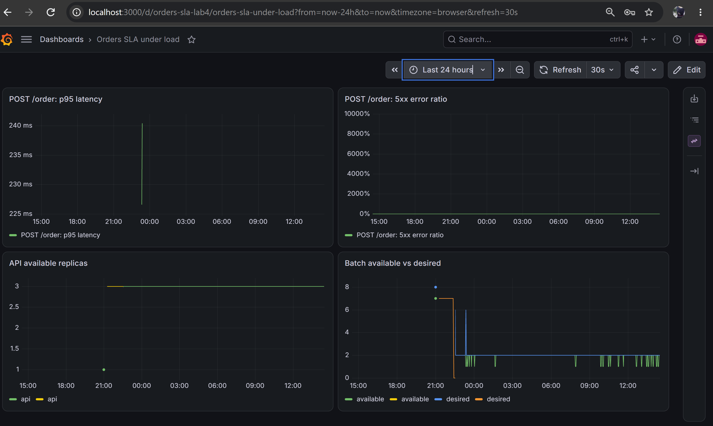

Для проверки срабатываня алерта OrdersBatchDegraded повторим нагрузку на `batch` из Части 8 и подождём дольше минуты плюс интервал оценки Prometheus.

Затем пробосим порт:
```
kubectl -n monitoring port-forward svc/prometheus-kube-prometheus-prometheus 9091:9090
```
И посмотрим состояние алертов:
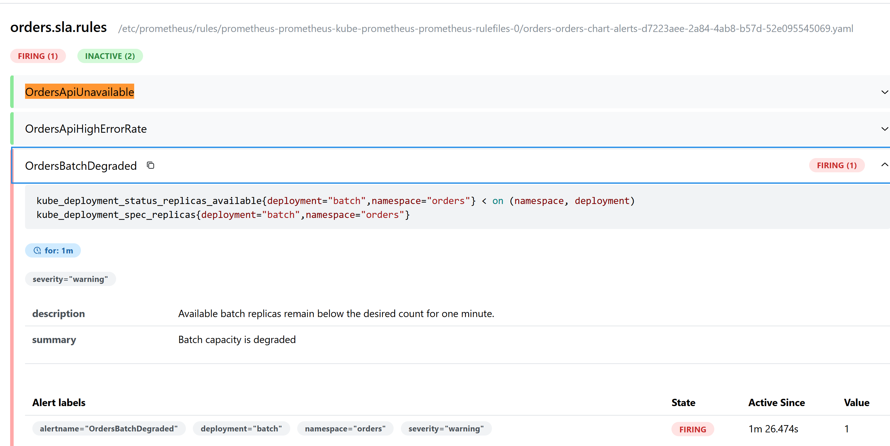
