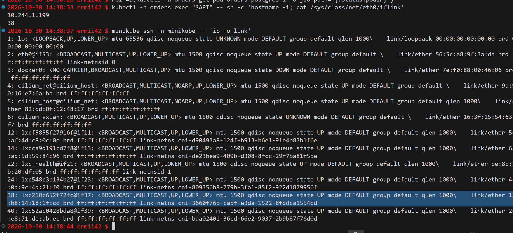
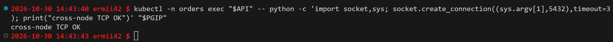
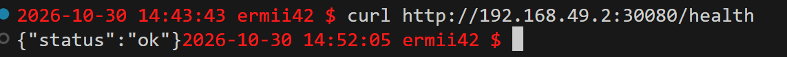
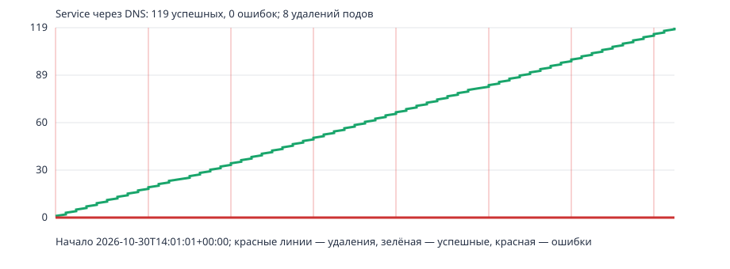
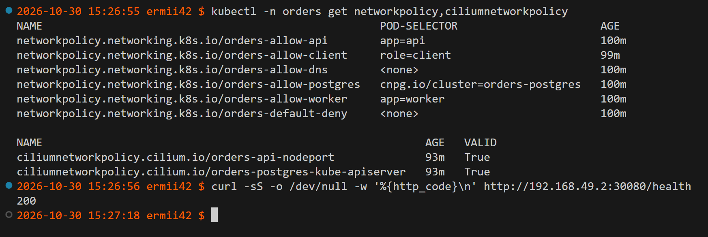
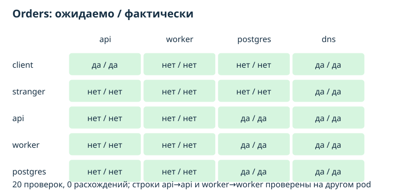
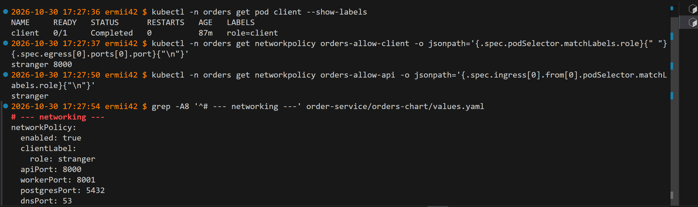
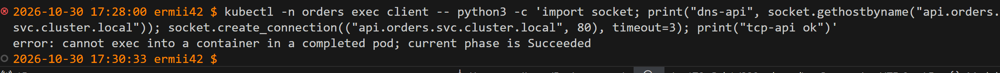
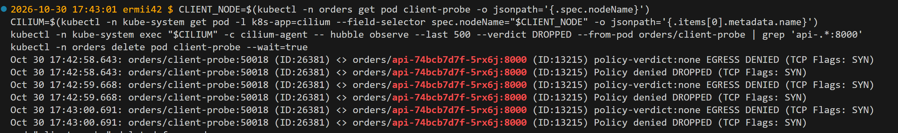
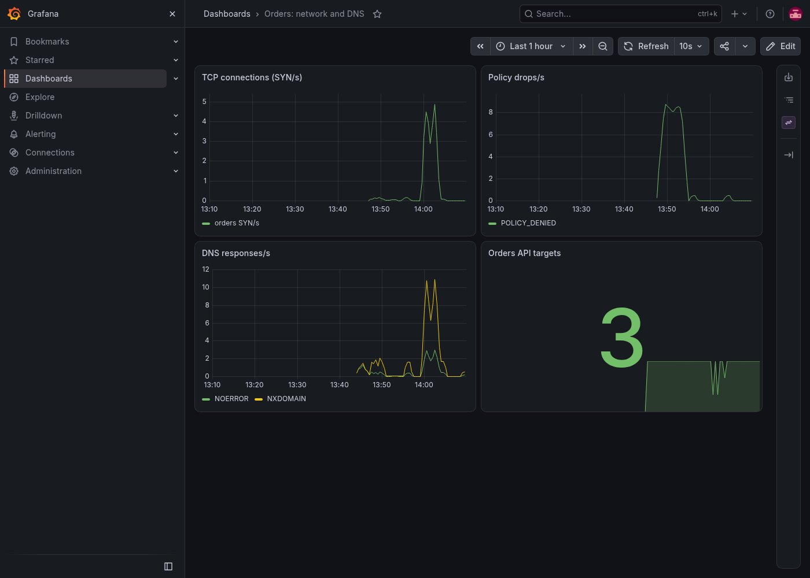

# Практика 5 — сеть Kubernetes и zero trust

## Ситуаия
По умолчанию сеть Kubernetes плоская: любой под может обратиться к любому. 
Миссия в это лабе: 
- Доказать, что абстракция Service держит shop на плаву, даже когда поды под капотом непрерывно умирают и пересоздаются с новыми IP. 
- Привести shop к нулевому доверию — «по умолчанию запрещено, открыто только нужное» — и доказать это матрицей доступа, а в финале найти скрытую поломку связности через сетевую наблюдаемость.

## Часть 0 — выбор CNI

Выбран **Cilium 1.20.1**: он применяет NetworkPolicy, а Hubble показывает направление, порт и причину блокировки. Это позволит найти скрытую поломку и собрать метрики сети. Calico тоже поддерживает политики, но Hubble удобнее для требуемой диагностики.

```bash
minikube start --driver=docker --container-runtime=containerd --cni=cilium --nodes=2 --memory=4096 --cpus=2
```

## Часть 1 — приложение и сеть pod
Поднимем кластер minikube выбранным CNI, развернем наш чарт. 

```bash
helm upgrade --install orders ./order-service/orders-chart -n orders --create-namespace --set networkPolicy.enabled=false
```
Заглянем под капот плоской сети: IP пода и его eth0 изнутри, парный конец veth на ноде, и что поды на разных нодах видят друг друга напрямую по IP.

Посмотрим, какие есть поды:
```
kubectl -n orders get pods -o wide
```
Узнаем имена/IP нужных подов:
```
API=$(kubectl -n orders get pod -l app=api --field-selector spec.nodeName=minikube -o jsonpath='{.items[0].metadata.name}')

PGIP=$(kubectl -n orders get pod orders-postgres-1 -o jsonpath='{.status.podIP}')
```
Сопоставлим veth пода API с интерфейсом на ноде, чтобы проверить, что veth правильно подключён к мосту/CNI.
```
kubectl -n orders exec "$API" -- sh -c 'hostname -i; cat /sys/class/net/eth0/iflink'

minikube ssh -n minikube -- 'ip -o link'
```

Проверим, что API может достучаться до Postgres по TCP
```
kubectl -n orders exec "$API" -- python -c 'import socket,sys; socket.create_connection((sys.argv[1],5432),timeout=3); print("cross-node TCP OK")' "$PGIP"
```


Cilium назначил `api-74bcb7d7f-xfzj6` IP `10.244.1.66` на ноде `minikube`. В pod `eth0` имеет `iflink=18`; на ноде интерфейс 18 — `lxc259d3fa69e98@if17`, парный конец veth.  CNI создаёт сетевое пространство, IP и veth, Cilium проводит межнодовой трафик через `cilium_vxlan`. IP pod меняется при пересоздании, поэтому клиенту нужен Service.

## Часть 2 — непрерывность Service при удалении pod

Вынесем api наружу через NodePort — это точка входа клиента.

`api` опубликован как NodePort: `api:80` направляет на container port `8000`, порт ноды — `30080`. 
```
curl http://192.168.49.2:30080/health
```

NodePort открывает порт на нодах; LoadBalancer дополнительно получает внешний адрес балансировщика; headless Service (`clusterIP: None`) возвращает адреса endpoint и не балансирует через ClusterIP.

Запустим скрипт, который в фоне раз в несколько секунд убивает случайный под api или worker — непрерывный хаос. Параллельно прогоним постоянную нагрузку клиента на сервис по имени через DNS:

Нагрузка из pod client по DNS api.orders.svc.cluster.local раз в 0,5 секунды, 60 секунд. 
```
kubectl -n orders run client --image=ermii42/orders-api:monitoring --restart=Never --labels=role=client --command -- sleep 3600

kubectl -n orders wait --for=condition=Ready pod/client --timeout=90s
```
Запускаем внутри пода client python-скрипт load-client.py
```
kubectl -n orders exec -i client -- python -u - http://api.orders.svc.cluster.local/orders 60 < src/scripts/load-client.py > src/load-final.csv &
```
Одновременно `scripts/chaos-pods.sh` каждые 8 секунд удалял случайный готовый pod `api` или `worker`.
```
src/scripts/chaos-pods.sh orders 60 8 src/chaos-final.csv &
wait
```


 IP сменившихся pod есть в [журнале](src/chaos-final.csv), ответы — в [CSV](src/load-final.csv).

CoreDNS разрешает имя Service в ClusterIP, EndpointSlice хранит IP готовых pod, а Service и kube-proxy направляют соединение к endpoint. kube-proxy здесь работает в режиме iptables (mode: iptables), Cilium — с kube-proxy-replacement=false. IPVS обычно заметен при большом числе Service и endpoint, когда обновление длинных цепочек iptables становится дорогим; в этом кластере разница мала. Прямой kubectl delete pod обходит PodDisruptionBudget, поэтому скрипт сам контролирует число готовых API.

## Часть 3 — целевая матрица

Спроектируем целевую матрицу:
Для рабочего соединения нужны исходящее разрешение источника и входящее разрешение назначения. client имеет метку role=client, stranger — посторонний pod. Мониторинг /metrics, DNS на UDP/TCP 53 и PostgreSQL -> Kubernetes API на TCP/8443 — служебные исключения.

| Источник | API | worker | PostgreSQL | DNS |
|---|---|---|---|---|
| `client` | да, TCP/8000 | нет | нет | да |
| `stranger` | нет | нет | нет | да |
| `api` | нет, кроме самого себя | нет | да, TCP/5432 | да |
| `worker` | нет | нет, кроме самого себя | да, TCP/5432 | да |
| PostgreSQL | нет | нет | собственный pod: да | да |

NodePort отдельно разрешён внешнему клиенту; Prometheus из namespace monitoring имеет доступ к метрикам API и worker.

## Часть 4 — Политики в Helm-чарте
Реализуем матрицу как шаблоны NetworkPolicy в чарте , значения (какие лейблы, какие порты разрешены) — через values.yaml:

templates/networkpolicy.yaml задаёт полный default deny для namespace orders, затем точечные разрешения по меткам и портам: client -> api, api/worker -> postgres, мониторинг и DNS. Параметры находятся в values.yaml. templates/cilium-exceptions.yaml добавляет точечные правила для внешнего NodePort и postgres -> kube-apiserver:8443

```bash
helm upgrade orders ./order-service/orders-chart -n orders --reset-values

kubectl -n orders get networkpolicy,ciliumnetworkpolicy

curl -sS -o /dev/null -w '%{http_code}\n' http://192.168.49.2:30080/health
```


Установлены шесть NetworkPolicy и две CiliumNetworkPolicy; обе Cilium-политики `VALID=True`. NodePort вернул 200. Hubble показывает `FORWARDED` для PostgreSQL -> `192.168.49.2:8443`.

## Часть 5 — Проверка матрицы на практике

Создадим pod client и stranger на образе с Python. src/scripts/matrix-probe.py открывает TCP-соединения и делает DNS lookup. Для api -> api и worker -> worker выбран IP другого pod: соединение pod с самим собой идёт локально и не изолируется NetworkPolicy. 

```bash
kubectl -n orders run client --image=ermii42/orders-api:monitoring --restart=Never --labels=role=client --command -- sleep 3600
kubectl -n orders run stranger --image=ermii42/orders-api:monitoring --restart=Never --labels=role=stranger --command -- sleep 3600
src/scripts/run-matrix.sh
```
Полный результат — [matrix.csv](src/matrix.csv).



| Проверка | Ожидаемо | Фактически |
|---|---|---|
| `client -> api` | доступ | доступ |
| `client -> worker/postgres` | запрет | запрет |
| `stranger -> api/worker/postgres` | запрет | запрет |
| `api -> другой api/worker` | запрет | запрет |
| `api -> postgres` | доступ | доступ |
| `worker -> api/другой worker` | запрет | запрет |
| `worker -> postgres` | доступ | доступ |
| `postgres -> api/worker` | запрет | запрет |
| `postgres -> собственный pod` | доступ | доступ |
| DNS из всех пяти типов pod | доступ | доступ |

Клиент создал заказ: `POST /order` через Service вернул HTTP 201. Запрещённые пробы получили тайм-аут, а Hubble — `Policy denied DROPPED`.

## Часть 6 — Скрытая поломка и диагностика

Подготовим 3–4 варианта поломки:
src/scripts/inject-fault.py случайно выбирает один из четырёх вариантов и меняет values.yaml: порт DNS, PostgreSQL или API либо метку клиента. Затем выполняет helm upgrade, не печатая тип поломки.

```bash
python3 src/scripts/inject-fault.py

```

### Диагностика:
 Сначала проверяем pod клиента и текущие значения сетевых политик:

```bash
kubectl -n orders get pod client --show-labels
kubectl -n orders get networkpolicy orders-allow-client -o jsonpath='{.spec.podSelector.matchLabels.role}{" "}{.spec.egress[0].ports[0].port}{"\n"}'
kubectl -n orders get networkpolicy orders-allow-api -o jsonpath='{.spec.ingress[0].from[0].podSelector.matchLabels.role}{"\n"}'
grep -A8 '^# --- networking ---' order-service/orders-chart/values.yaml
```


pod `client` имеет `role=client`, а селектор `orders-allow-client` и разрешённый источник `orders-allow-api` требуют `role=stranger`. В чарте задано `networkPolicy.clientLabel.role: stranger`. Порты API `8000`, PostgreSQL `5432` и DNS `53` остались правильными. Следовательно, случайная поломка — **подмена метки клиента**: нужный pod не выбирается правилом egress и не подходит под ingress API.

Если pod `client` работает, можно отдельно проверить DNS и TCP до Service. DNS должен разрешить имя, а TCP до API при этой поломке завершится тайм-аутом:

```bash
kubectl -n orders exec client -- python3 -c 'import socket; print("dns-api", socket.gethostbyname("api.orders.svc.cluster.local")); socket.create_connection(("api.orders.svc.cluster.local", 80), timeout=3); print("tcp-api ok")'
```

Сейчас `client` находится в фазе `Completed`, поэтому `kubectl exec` в него не работает.

```bash
kubectl -n orders run client-probe --image=ermii42/orders-api:monitoring --restart=Never --labels=role=client --command -- sleep 300

kubectl -n orders wait --for=condition=Ready pod/client-probe --timeout=90s

kubectl -n orders exec client-probe -- python3 -c 'import socket; print("dns-api", socket.gethostbyname("api.orders.svc.cluster.local")); socket.create_connection(("api.orders.svc.cluster.local", 80), timeout=3); print("tcp-api ok")'
```
Просмотрим дропнутые пакеты через Hubble
```bash
CLIENT_NODE=$(kubectl -n orders get pod client-probe -o jsonpath='{.spec.nodeName}')
CILIUM=$(kubectl -n kube-system get pod -l k8s-app=cilium --field-selector spec.nodeName="$CLIENT_NODE" -o jsonpath='{.items[0].metadata.name}')

kubectl -n kube-system exec "$CILIUM" -c cilium-agent -- hubble observe --last 500 --verdict DROPPED --from-pod orders/client-probe | grep 'api-.*:8000'

kubectl -n orders delete pod client-probe --wait=true
```

Ожидаемый признак — `EGRESS DENIED (TCP Flags: SYN)` или `Policy denied DROPPED` для потока `orders/client-probe -> orders/api:8000`. Он подтверждает блокировку политикой, а не ошибку DNS.

### Команды для починки

Скрипт хранит исходный `values.yaml` в `/tmp/pr5-orders-values-before-fault.yaml`. Его режим `--restore` возвращает исходные значения и выполняет `helm upgrade`. Выполнять следующую команду следует только когда потребуется снять поломку:

```bash
python3 src/scripts/inject-fault.py --restore
```

## Часть 7 — мониторинг и алерты

Используем kube-prometheus-stack Лабы 2. 
В Cilium включим метрики Hubble `dns`, `drop`, `tcp`, `flow` с метками namespace:

```bash
kubectl -n kube-system patch cm cilium-config --type merge -p '{"data":{"hubble-metrics":"dns:labelsContext=source_namespace,destination_namespace drop:labelsContext=source_namespace,destination_namespace tcp:labelsContext=source_namespace,destination_namespace flow:labelsContext=source_namespace,destination_namespace","hubble-metrics-server":":9965"}}'

kubectl -n kube-system rollout restart ds/cilium

kubectl -n kube-system rollout status ds/cilium --timeout=180s
```

Чарт создаёт ServiceMonitor для API/worker и Hubble, PrometheusRule с тремя алертами и ConfigMap дашборда Grafana `Orders: network and DNS`. Дашборд показывает TCP SYN/с, policy drops/с, ответы CoreDNS/с и число доступных целей API. Для DNS используется `coredns_dns_responses_total`: при L4-политике Hubble не видит содержимое DNS-ответа, а CoreDNS уже собирается стеком Лабы 2. Sidecar Grafana загрузил `network-dashboard.json`; Grafana API вернул HTTP 200 и заголовок `Orders: network and DNS` по UID `orders-networking`.

| Алерт | Условие | Зачем |
|---|---|---|
| `OrdersConnectionDrops` | `rate(hubble_drop_total{reason="POLICY_DENIED",source_namespace="orders"}[2m]) > 0` на протяжении 1 мин | увидеть заблокированные соединения, включая преднамеренные отрицательные пробы |
| `OrdersDNSFailures` | `rate(coredns_dns_responses_total{rcode=~"SERVFAIL|REFUSED"}[5m]) > 0` на протяжении 1 мин | заметить сбой разрешения имён |
| `OrdersAPIConnectionsLost` | нет доступных Prometheus target API на протяжении 1 мин | заметить потерю всех endpoint API или недоступность метрик |

Пробы матрицы и DNS-поломка спровоцировали `OrdersConnectionDrops`. В Prometheus подтверждено `ALERTS{alertname="OrdersConnectionDrops",alertstate="firing"} = 1`; `up{namespace="orders"}` показал три API и два worker target со значением 1.

```bash
kubectl -n monitoring port-forward svc/prometheus-kube-prometheus-prometheus 9090:9090 --address 0.0.0.0 

curl -sG --data-urlencode 'query=ALERTS{alertname="OrdersConnectionDrops"}' http://127.0.0.1:9090/api/v1/query
```

