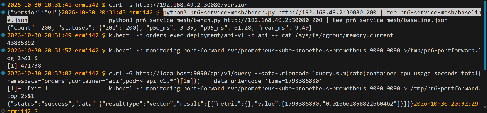
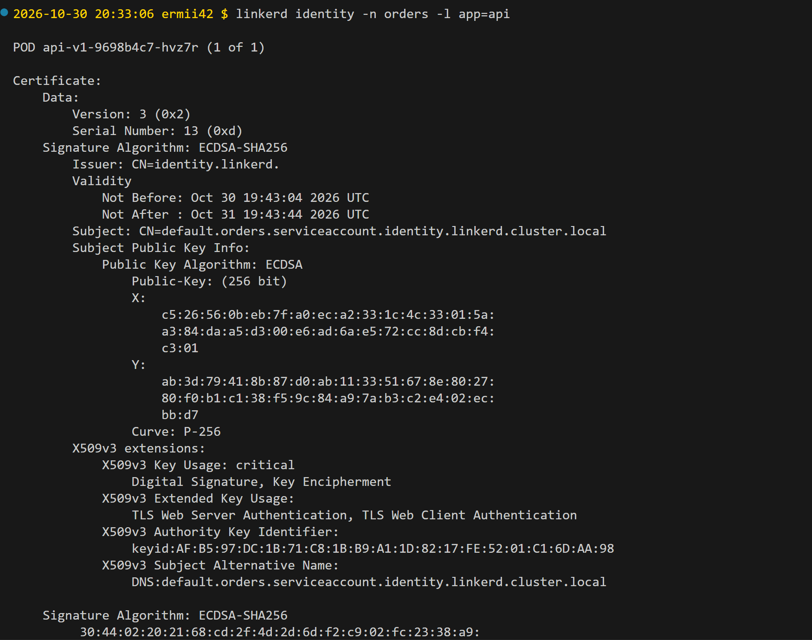
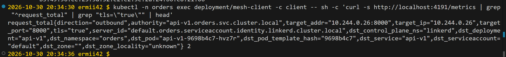
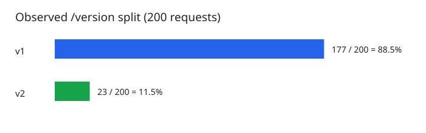
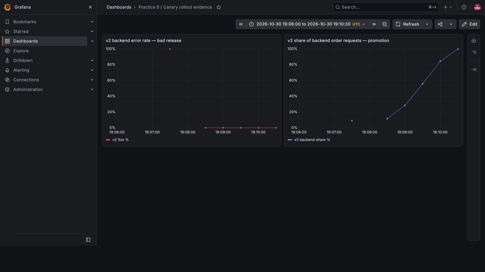
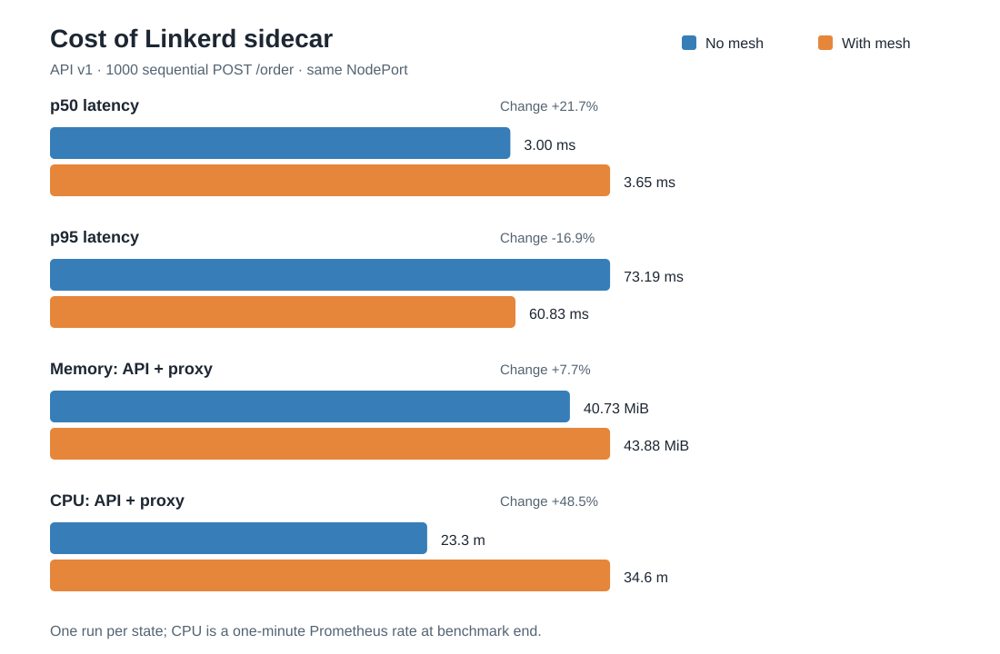
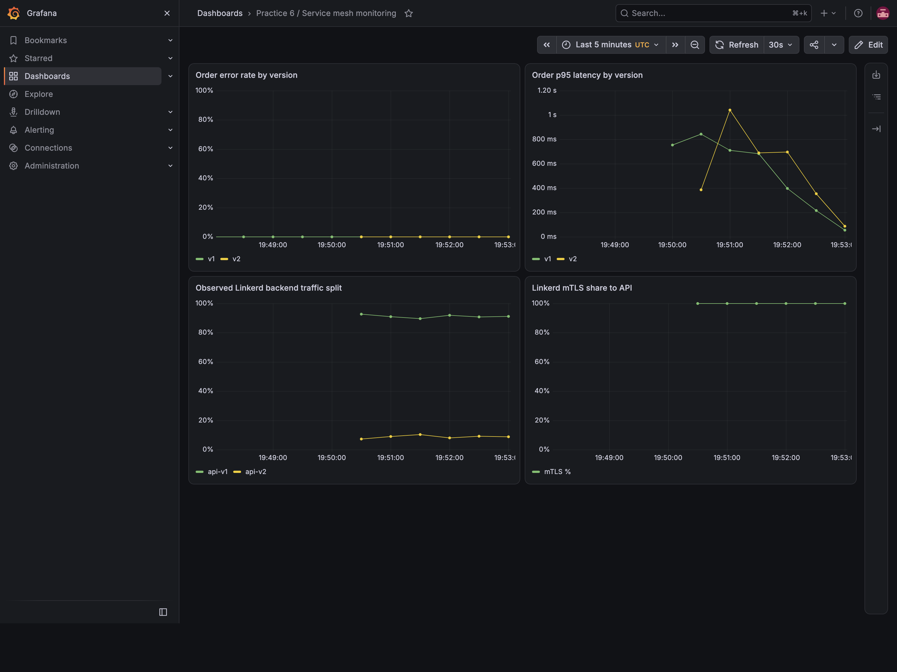

# Практика 6 — service mesh и автопилот релиза
## Ситуация

Service mesh обещает шифрование, надёжность и умное управление трафиком без правок кода. В этой лабе проверяем всё это делом на `api` из чарта `shop`: сначала доказываем, что mesh даёт шифрование и надёжность бесплатно, потом строишь поверх него самоуправляемый канареечный релиз — новая версия получает малую долю трафика, скрипт-гейт сам следит за её здоровьем и автоматически докатывает при успехе или откатывает при росте ошибок, без человека. В конце — честный подсчёт цены: во сколько (задержка, ресурсы) обошлась вся эта магия, и вердикт, нужен ли здесь mesh вообще.

## Часть 0 — Сервисы и гейт

В `order-service/app/api/app.py` добавлены `GET /version`, переменные `VERSION`, `FAIL`, `FLAKY`. v1 при `FLAKY=true` случайно возвращает 500 на 30% вызовов `POST /order` до записи в БД; v2 при `FAIL=true` возвращает 500 на каждом вызове. `GET /health`, `GET /orders`, `POST /order` сохранены. Метрики запросов и задержки содержат label `version`. Оба варианта используют один образ с разным окружением. Ошибка вводится до изменения состояния БД, поэтому повтор POST в этом опыте не создаёт дубль; в обычном приложении нужен идемпотентный ключ.

`gate.py` каждые 15 секунд читает Prometheus и меняет веса HTTPRoute; контейнерный вариант описан в `Dockerfile.gate` (для запуска нужен Kubernetes ServiceAccount с правом patch HTTPRoute). `bench.py` измеряет baseline, `reliability.py` сравнивает ошибки backend и клиента на одном наборе запросов, `plot_results.py` строит SVG.

```bash
python3 -m py_compile pr6-service-mesh/order-service/app/api/app.py
minikube image build -t orders-api:pr6 pr6-service-mesh/order-service/app/api
minikube image build --node minikube-m02 -t orders-api:pr6 pr6-service-mesh/order-service/app/api
```

Образ собран на обоих узлах, поскольку pod может оказаться на любом из них. Dockerfile гейта проверен командой `docker build -f pr6-service-mesh/Dockerfile.gate -t orders-gate:pr6 pr6-service-mesh`.

## Часть 1 — Выбор mesh

Выбран **Linkerd edge-26.10.2**: для задачи нужны mTLS, наблюдаемые повторы и взвешенный HTTPRoute; прокси внедряется только в API и тестовый клиент. Linkerd поддерживает mTLS, retry-аннотации и HTTPRoute. Установлены совместимые Gateway API CRD v1.2.1.

```bash
curl --proto '=https' --tlsv1.2 -sSfL https://run.linkerd.io/install-edge | sh
export PATH=$PATH:/home/ermii42/.linkerd2/bin
kubectl apply -f https://github.com/kubernetes-sigs/gateway-api/releases/download/v1.2.1/standard-install.yaml
linkerd check --pre
linkerd install --crds | kubectl apply -f -
linkerd install | kubectl apply -f -
linkerd check
```

`linkerd check` завершился успешно. Проверка доступности сервера версий вывела предупреждение из-за TLS timeout; компоненты control plane прошли проверку. [Инструкция Linkerd](https://linkerd.io/docs/getting-started/).

## Часть 2 — Baseline без mesh

Был запущен только API v1 и существующий Postgres. Worker имеет 0 реплик. Временные значения: `mesh.enabled=false`, `mesh.clientEnabled=false`, `api.v2.enabled=false`.

```bash
helm upgrade --install --reset-values orders pr6-service-mesh/order-service/orders-chart -n orders --wait --timeout 180s --set mesh.enabled=false --set mesh.clientEnabled=false --set api.v2.enabled=false
curl -s http://192.168.49.2:30080/version
python3 pr6-service-mesh/bench.py http://192.168.49.2:30080 200 | tee pr6-service-mesh/baseline.json
kubectl -n orders exec deployment/api-v1 -c api -- cat /sys/fs/cgroup/memory.current
kubectl -n monitoring port-forward svc/prometheus-kube-prometheus-prometheus 9090:9090 >/tmp/pr6-portforward.log 2>&1 &
curl -G http://localhost:9090/api/v1/query --data-urlencode 'query=sum(rate(container_cpu_usage_seconds_total{namespace="orders",container="api",pod=~"api-v1.*"}[1m]))' --data-urlencode 'time=1793386830'
```


## Часть 3 — mTLS и identity

Аннотация `linkerd.io/inject: enabled` задаётся в шаблоне Deployment из `mesh.enabled`. В mesh включены API и `mesh-client`; Postgres и worker не инжектируются. На каждом meshed pod видно два контейнера.

```bash
helm upgrade --reset-values orders pr6-service-mesh/order-service/orders-chart -n orders --force-conflicts --wait --timeout 180s --set mesh.enabled=true --set mesh.clientEnabled=true --set api.v2.enabled=false
kubectl -n orders get pods -l 'app in (api,mesh-client)'
linkerd identity -n orders -l app=api
kubectl -n orders exec deployment/mesh-client -c client -- curl -s http://localhost:4191/metrics | grep 'tls="true"' | head
```


Сертификат API: `Subject: CN=default.orders.serviceaccount.identity.linkerd.cluster.local`, `Issuer: CN=identity.linkerd.`, SAN содержит тот же DNS identity, расширения разрешают TLS server/client authentication. Прокси клиента показал `request_total` к API с `tls="true"` и `server_id="default.orders.serviceaccount.identity.linkerd.cluster.local"` . Это подтверждает шифрование и проверку сервисной identity сертификатом; IP в метрике — адрес доставки, а не удостоверение сервиса.

## Часть 4 — Надёжность через retries

Сервис `api-v1` в чарте имеет `retry.linkerd.io/http: "500-504"` и `retry.linkerd.io/limit: "3"`. При `FLAKY=true` запущены 300 POST с meshed-клиента прямо в `api-v1`. Скрипт `reliability.py` снял счётчики приложения и прокси до и после ровно этого прогона.

```bash
helm upgrade --reset-values orders pr6-service-mesh/order-service/orders-chart -n orders --force-conflicts --set api.flaky=true --wait --timeout 180s
python3 pr6-service-mesh/reliability.py
helm upgrade --reset-values orders pr6-service-mesh/order-service/orders-chart -n orders --force-conflicts --wait --timeout 180s
```


Backend обработал **412 попыток**, из них **112 ответов 500 (27,18%)**. Клиент получил **0 ответов 500 из 300**. Счётчик Linkerd `outbound_http_route_retry_requests_total` вырос на **112**. Значит, сработали повторы запросов. Circuit breaking/outlier detection в этом опыте не настраивались. Данные сохранены в `reliability.json`.

## Часть 5 — Разделение 90/10

Чарт создаёт Deployment `api-v1`/`api-v2`, Service `api-v1`/`api-v2`, общий Service `api` и `HTTPRoute/api-split` с весами из `api.v2.weight`. Клиент инжектирован в Linkerd: маршрутизация происходит в его outbound proxy. `HTTPRoute` принят контроллером (`Accepted=True`, `ResolvedRefs=True`).

```bash
helm upgrade --reset-values orders pr6-service-mesh/order-service/orders-chart -n orders --force-conflicts --wait --timeout 180s --set api.v2.enabled=true --set api.v2.weight=10 --set api.v2.fail=true --set mesh.loadEnabled=true
kubectl -n orders get httproute api-split -o yaml
kubectl -n orders exec deployment/mesh-client -c client -- sh -c 'for i in $(seq 1 200); do curl -s http://api.orders.svc.cluster.local/version; echo; done' | sort | uniq -c
```

При весах 90/10 получено **177 ответов v1 и 23 ответа v2** из 200 (88,5/11,5%).


 Взвешенный выбор вероятностный, поэтому малое отклонение ожидаемо.

## Часть 6 — Автопилот

Гейт использует `http_requests_total{version="v2",service="api-v2",path="/order"}`: `increase(...[1m])` для числа запросов и статусов 5xx; `histogram_quantile(0.95, sum by (le)(rate(http_request_duration_seconds_bucket{...}[1m])))` для p95 задержки v2. Если в минутном окне меньше 10 запросов, гейт ждёт. Если доля 5xx больше 5%, ставит вес v2 в 0. Если ошибок не больше 5% и p95 не выше 0,5 с, прибавляет 20 процентных пунктов, максимум до 100. JSON Patch применяется к `HTTPRoute` каждые 15 с; решения и метрики пишутся в CSV.

```bash
kubectl -n monitoring port-forward svc/prometheus-kube-prometheus-prometheus 9090:9090 >/tmp/pr6-portforward.log 2>&1 &
python3 pr6-service-mesh/gate.py --output pr6-service-mesh/bad-release.csv --seconds 180
```

Prometheus сканирует API каждые 30 с, поэтому сразу после создания нового pod гейт может видеть 0 наблюдений и ждёт данные. После `kubectl patch` Helm 4 при следующем upgrade может сообщить о конфликте владения `spec.rules`; для возврата весов из чарта использовались `helm upgrade --reset-values --force-conflicts`: первый флаг сбрасывает временные `--set`, второй возвращает управление полями маршрута Helm.

## Часть 7 — Плохой и хороший релизы

**Плохой релиз.** v2 с `FAIL=true` стартовала с 10%. После накопления метрик гейт увидел около 36 запросов за минуту и 100% ошибок v2, затем самостоятельно изменил веса **90/10 → 100/0** за 15 с. Подробные значения — в `bad-release.csv`.


**Хороший релиз.** v2 обновлена с `FAIL=false`, веса возвращены к 90/10 через чарт. После двух ожидающих итераций Prometheus гейт последовательно поднял v2 до **30, 50, 70, 90 и 100%**. На каждом шаге доля ошибок v2 была 0%, p95 приложения — 4,7–8,2 мс. Подробные значения — в `good-release.csv`.

```bash
helm upgrade --reset-values orders pr6-service-mesh/order-service/orders-chart -n orders --force-conflicts --wait --timeout 180s --set api.v2.weight=10 --set api.v2.fail=false --set mesh.loadEnabled=true
python3 pr6-service-mesh/gate.py --output pr6-service-mesh/good-release.csv --seconds 180
python3 pr6-service-mesh/plot_results.py
helm upgrade --reset-values orders pr6-service-mesh/order-service/orders-chart -n orders --force-conflicts --wait --timeout 180s
kubectl -n orders get httproute api-split -o jsonpath='{.spec.rules[0].backendRefs[*].weight}'
```


Состояние canary и метрики релиза также зафиксированы на скриншоте Grafana:



## Часть 8 — Цена mesh и вердикт

Для сравнения выполнены два новых прогона по **1000 последовательных `POST /order`** на одном NodePort `192.168.49.2:30080`. В обоих случаях работала только v1, `FAIL=false`, `FLAKY=false`; внешний клиент не был включён в mesh. Между прогонами менялось только внедрение Linkerd sidecar в API. Так сравнение точнее исходного baseline из части 2 (там было 200 запросов). Результаты сохранены в `ab-baseline.json`, `ab-mesh.json` и `ab-resources.json`.

```bash
helm upgrade --reset-values orders pr6-service-mesh/order-service/orders-chart -n orders --force-conflicts --set mesh.enabled=false --set mesh.clientEnabled=false --set api.v2.enabled=false --wait --timeout 180s
python3 pr6-service-mesh/bench.py http://192.168.49.2:30080 1000 | tee pr6-service-mesh/ab-baseline.json
helm upgrade --reset-values orders pr6-service-mesh/order-service/orders-chart -n orders --force-conflicts --set mesh.enabled=true --set mesh.clientEnabled=false --set api.v2.enabled=false --wait --timeout 180s
python3 pr6-service-mesh/bench.py http://192.168.49.2:30080 1000 | tee pr6-service-mesh/ab-mesh.json
python3 pr6-service-mesh/plot_cost.py
```

После каждого прогона снимались `container_memory_usage_bytes` и минутная скорость `container_cpu_usage_seconds_total` для контейнеров `api` и `linkerd-proxy` соответствующего pod. Пример запросов к Prometheus (имя pod подставляется из `kubectl get pods`):

```bash
kubectl -n orders get pods -l app=api,version=v1
curl -G http://localhost:9090/api/v1/query --data-urlencode 'query=container_memory_usage_bytes{namespace="orders",pod="<POD>",container=~"api|linkerd-proxy"}'
curl -G http://localhost:9090/api/v1/query --data-urlencode 'query=rate(container_cpu_usage_seconds_total{namespace="orders",pod="<POD>",container=~"api|linkerd-proxy"}[1m])'
```

| Показатель | Без mesh | С mesh | Разница |
| --- | ---: | ---: | ---: |
| Успешные ответы | 1000/1000 | 1000/1000 | 0 |
| p50 задержки | 3,00 мс | 3,65 мс | +0,65 мс (+21,7%) |
| p95 задержки | 73,19 мс | 60,83 мс | −12,36 мс (−16,9%) |
| Средняя задержка | 10,72 мс | 9,37 мс | −1,35 мс (−12,6%) |
| Память API + proxy | 40,73 MiB | 43,88 MiB | +3,15 MiB (+7,7%) |
| CPU API + proxy | 23,3m | 34,6m | +11,3m (+48,5%) |



В этом прогоне заметен рост медианы, памяти и CPU. Уменьшение p95 и среднего нельзя считать доказанным ускорением: каждый вариант запускался один раз, на задержку влияет состояние узла и БД, а CPU измерен по минутному окну. Путь через NodePort измеряет входящий sidecar API, но не полную стоимость внутреннего mTLS-вызова между двумя прокси. 
**Вердикт:** для одной небольшой API с БД расход дополнительных 3,15 MiB и около 11m CPU не окупается сам по себе; в рамках этой практики mesh оправдан проверяемыми mTLS, повторами и управляемым canary. Перед применением на большой нагрузке нужны повторные прогоны и отдельный тест внутренних вызовов.

## Часть 9 — Мониторинг

В чарт добавлены отдельные сервисы порта `4191` для прокси `api-v1`, `api-v2`, `mesh-client` и `ServiceMonitor` для них. Существующие `ServiceMonitor` API и worker сохранены; API monitor выбирает только сервисы версий, чтобы метрики v1 не собирались повторно через общий сервис `api`. `PrometheusRule` с тремя правилами находится в `templates/prometheusrule.yaml`. Prometheus увидел все три proxy target со статусом `up=1` и загрузил все три правила.

```bash
helm upgrade --reset-values orders pr6-service-mesh/order-service/orders-chart -n orders --force-conflicts --wait --timeout 180s
kubectl -n orders get servicemonitor,prometheusrule
kubectl -n orders get svc api-v1-proxy api-v2-proxy mesh-client-proxy
curl -G http://localhost:9090/api/v1/query --data-urlencode 'query=up{namespace="orders",service=~".*-proxy"}'
curl -s 'http://localhost:9090/api/v1/rules?type=alert'
```

Правила:

1. **`OrdersCanaryHighErrorRate`** — доля HTTP 5xx у `POST /order` v2 выше 5% в течение минуты при нагрузке более 0,1 запроса/с. Порог совпадает с гейтом из части 6 и сигнализирует о плохом canary после развёртывания.
2. **`OrdersCanaryHighLatency`** — p95 `POST /order` v2 выше 500 мс в течение пяти минут при той же минимальной нагрузке. Порог совпадает с гейтом; длительное окно уменьшает шум от разовых медленных запросов.
3. **`OrdersMeshUnencryptedTraffic`** — за пять минут появился хотя бы один исходящий запрос `mesh-client` к `api-v1` или `api-v2` без `tls="true"`. Это сигнал о потере ожидаемого mTLS или инжекции прокси. Правило относится к meshed-клиенту, поскольку внешний NodePort-клиент в mesh не входит.

Дашборд `grafana-monitoring-dashboard.json` импортирован в Grafana как **Practice 6 / Service mesh monitoring** (`pr6-mesh-monitoring`). Он показывает долю ошибок и p95 по версиям из метрик приложения, фактическое разделение v1/v2 и долю mTLS из [метрик прокси Linkerd](https://linkerd.io/docs/reference/proxy-metrics/index.html). Для снимка на время включались 90/10 и генератор запросов; на дашборде видны примерно 92/8 и 100% mTLS. После снимка штатные значения чарта возвращены: v2 = 100%, генератор выключен.

```bash
helm upgrade --reset-values orders pr6-service-mesh/order-service/orders-chart -n orders --force-conflicts --wait --timeout 180s --set api.v2.weight=10 --set mesh.loadEnabled=true
kubectl -n monitoring port-forward svc/prometheus-grafana 3000:80 >/tmp/pr6-grafana.log 2>&1 &
GRAFANA_PASSWORD=$(kubectl -n monitoring get secret prometheus-grafana -o jsonpath='{.data.admin-password}' | base64 -d)
curl -u "admin:$GRAFANA_PASSWORD" -H "Content-Type: application/json" --data-binary @pr6-service-mesh/grafana-monitoring-dashboard.json http://localhost:3000/api/dashboards/db
# Снимок открытого дашборда сохранён как grafana-monitoring.png.
helm upgrade --reset-values orders pr6-service-mesh/order-service/orders-chart -n orders --force-conflicts --wait --timeout 180s
```



