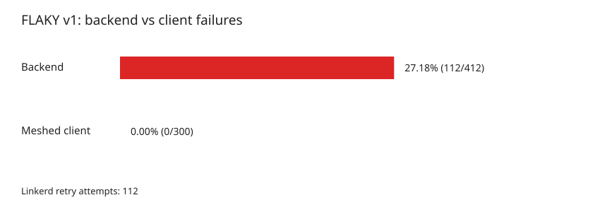
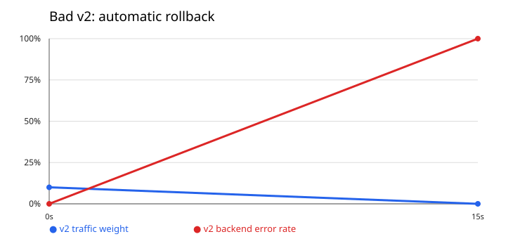
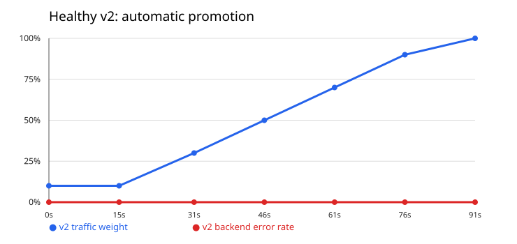

# Практика 6 — service mesh и автопилот релиза


## Часть 0 — Сервисы и гейт

В `order-service/app/api/app.py` добавлены `GET /version`, переменные `VERSION`, `FAIL`, `FLAKY`. v1 при `FLAKY=true` случайно возвращает 500 на 30% вызовов `POST /order` до записи в БД; v2 при `FAIL=true` возвращает 500 на каждом вызове. `GET /health`, `GET /orders`, `POST /order` сохранены. Метрики запросов и задержки содержат label `version`. Оба варианта используют один образ с разным окружением. Ошибка вводится до изменения состояния БД, поэтому повтор POST в этом опыте не создаёт дубль; в обычном приложении нужен идемпотентный ключ.

`gate.py` каждые 15 секунд читает Prometheus и меняет веса HTTPRoute; контейнерный вариант описан в `Dockerfile.gate` (для запуска нужен Kubernetes ServiceAccount с правом patch HTTPRoute). `bench.py` измеряет baseline, `reliability.py` сравнивает ошибки backend и клиента на одном наборе запросов, `plot_results.py` строит SVG.

```bash
python3 -m py_compile pr6-service-mesh/order-service/app/api/app.py
minikube image build -t orders-api:pr6 pr6-service-mesh/order-service/app/api
minikube image build --node minikube-m02 -t orders-api:pr6 pr6-service-mesh/order-service/app/api
```

Образ собран на обоих узлах, поскольку pod может оказаться на любом из них. Dockerfile гейта проверен командой `docker build -f pr6-service-mesh/Dockerfile.gate -t orders-gate:pr6 pr6-service-mesh`.

## Часть 1 — Выбор mesh

Выбран **Linkerd edge-26.10.2**: для задачи нужны mTLS, наблюдаемые повторы и взвешенный HTTPRoute; прокси внедряется только в API и тестовый клиент. Linkerd поддерживает [mTLS](https://linkerd.io/docs/features/automatic-mtls/), [retry-аннотации](https://linkerd.io/docs/reference/retries/) и [HTTPRoute](https://linkerd.io/docs/reference/httproute/). Установлены совместимые Gateway API CRD v1.2.1.

```bash
curl --proto '=https' --tlsv1.2 -sSfL https://run.linkerd.io/install-edge | sh
export PATH=$PATH:/home/ermii42/.linkerd2/bin
kubectl apply -f https://github.com/kubernetes-sigs/gateway-api/releases/download/v1.2.1/standard-install.yaml
linkerd check --pre
linkerd install --crds | kubectl apply -f -
linkerd install | kubectl apply -f -
linkerd check
```

`linkerd check` завершился успешно. Проверка доступности сервера версий вывела предупреждение из-за TLS timeout; компоненты control plane прошли проверку. [Инструкция Linkerd](https://linkerd.io/docs/getting-started/).

## Часть 2 — Baseline без mesh

Был запущен только API v1 и существующий Postgres. Worker имеет 0 реплик. Временные значения: `mesh.enabled=false`, `mesh.clientEnabled=false`, `api.v2.enabled=false`.

```bash
helm upgrade --install --reset-values orders pr6-service-mesh/order-service/orders-chart -n orders --wait --timeout 180s --set mesh.enabled=false --set mesh.clientEnabled=false --set api.v2.enabled=false
curl -s http://192.168.49.2:30080/version
python3 pr6-service-mesh/bench.py http://192.168.49.2:30080 200 | tee pr6-service-mesh/baseline.json
kubectl -n orders exec deployment/api-v1 -c api -- cat /sys/fs/cgroup/memory.current
kubectl -n monitoring port-forward svc/prometheus-kube-prometheus-prometheus 9090:9090 >/tmp/pr6-portforward.log 2>&1 &
curl -G http://localhost:9090/api/v1/query --data-urlencode 'query=sum(rate(container_cpu_usage_seconds_total{namespace="orders",container="api",pod=~"api-v1.*"}[1m]))' --data-urlencode 'time=1793386830'
```

Результат 200 последовательных POST: **200 ответов 201**, p50 **2,95 мс**, p95 **74,34 мс**, среднее **11,01 мс**. После нагрузки память API — **43 565 056 байт (41,55 MiB)**. Prometheus показал **0,01666 CPU core (16,66m)** для минутного окна около 19:00:30 UTC. CPU request/limit — 200m. Данные сохранены в `baseline.json` и `baseline-resource.json`. Нагрузка шла с ВМ на NodePort без прокси.

## Часть 3 — mTLS и identity

Аннотация `linkerd.io/inject: enabled` задаётся в шаблоне Deployment из `mesh.enabled`. В mesh включены API и `mesh-client`; Postgres и worker не инжектируются. На каждом meshed pod видно два контейнера.

```bash
helm upgrade --reset-values orders pr6-service-mesh/order-service/orders-chart -n orders --force-conflicts --wait --timeout 180s --set mesh.enabled=true --set mesh.clientEnabled=true --set api.v2.enabled=false
kubectl -n orders get pods -l 'app in (api,mesh-client)'
linkerd identity -n orders -l app=api
kubectl -n orders exec deployment/mesh-client -c client -- curl -s http://localhost:4191/metrics | grep 'tls="true"' | head
```

Сертификат API: `Subject: CN=default.orders.serviceaccount.identity.linkerd.cluster.local`, `Issuer: CN=identity.linkerd.`, SAN содержит тот же DNS identity, расширения разрешают TLS server/client authentication. Прокси клиента показал `request_total` к API с `tls="true"` и `server_id="default.orders.serviceaccount.identity.linkerd.cluster.local"` (159 запросов на момент проверки). Это подтверждает шифрование и проверку сервисной identity сертификатом; IP в метрике — адрес доставки, а не удостоверение сервиса.

## Часть 4 — Надёжность через retries

Сервис `api-v1` в чарте имеет `retry.linkerd.io/http: "500-504"` и `retry.linkerd.io/limit: "3"`. При `FLAKY=true` запущены 300 POST с meshed-клиента прямо в `api-v1`. Скрипт `reliability.py` снял счётчики приложения и прокси до и после ровно этого прогона.

```bash
helm upgrade --reset-values orders pr6-service-mesh/order-service/orders-chart -n orders --force-conflicts --set api.flaky=true --wait --timeout 180s
python3 pr6-service-mesh/reliability.py
helm upgrade --reset-values orders pr6-service-mesh/order-service/orders-chart -n orders --force-conflicts --wait --timeout 180s
```



Backend обработал **412 попыток**, из них **112 ответов 500 (27,18%)**. Клиент получил **0 ответов 500 из 300**. Счётчик Linkerd `outbound_http_route_retry_requests_total` вырос на **112**. Значит, сработали повторы запросов. Circuit breaking/outlier detection в этом опыте не настраивались. Данные сохранены в `reliability.json`.

## Часть 5 — Разделение 90/10

Чарт создаёт Deployment `api-v1`/`api-v2`, Service `api-v1`/`api-v2`, общий Service `api` и `HTTPRoute/api-split` с весами из `api.v2.weight`. Клиент инжектирован в Linkerd: маршрутизация происходит в его outbound proxy. `HTTPRoute` принят контроллером (`Accepted=True`, `ResolvedRefs=True`).

```bash
helm upgrade --reset-values orders pr6-service-mesh/order-service/orders-chart -n orders --force-conflicts --wait --timeout 180s --set api.v2.enabled=true --set api.v2.weight=10 --set api.v2.fail=true --set mesh.loadEnabled=true
kubectl -n orders get httproute api-split -o yaml
kubectl -n orders exec deployment/mesh-client -c client -- sh -c 'for i in $(seq 1 200); do curl -s http://api.orders.svc.cluster.local/version; echo; done' | sort | uniq -c
```

При весах 90/10 получено **177 ответов v1 и 23 ответа v2** из 200 (88,5/11,5%).


 Взвешенный выбор вероятностный, поэтому малое отклонение ожидаемо.

## Часть 6 — Автопилот

Гейт использует `http_requests_total{version="v2",service="api-v2",path="/order"}`: `increase(...[1m])` для числа запросов и статусов 5xx; `histogram_quantile(0.95, sum by (le)(rate(http_request_duration_seconds_bucket{...}[1m])))` для p95 задержки v2. Если в минутном окне меньше 10 запросов, гейт ждёт. Если доля 5xx больше 5%, ставит вес v2 в 0. Если ошибок не больше 5% и p95 не выше 0,5 с, прибавляет 20 процентных пунктов, максимум до 100. JSON Patch применяется к `HTTPRoute` каждые 15 с; решения и метрики пишутся в CSV.

```bash
kubectl -n monitoring port-forward svc/prometheus-kube-prometheus-prometheus 9090:9090 >/tmp/pr6-portforward.log 2>&1 &
python3 pr6-service-mesh/gate.py --output pr6-service-mesh/bad-release.csv --seconds 180
```

Prometheus сканирует API каждые 30 с, поэтому сразу после создания нового pod гейт может видеть 0 наблюдений и ждёт данные. После `kubectl patch` Helm 4 при следующем upgrade может сообщить о конфликте владения `spec.rules`; для возврата весов из чарта использовались `helm upgrade --reset-values --force-conflicts`: первый флаг сбрасывает временные `--set`, второй возвращает управление полями маршрута Helm.

## Часть 7 — Плохой и хороший релизы

**Плохой релиз.** v2 с `FAIL=true` стартовала с 10%. После накопления метрик гейт увидел около 36 запросов за минуту и 100% ошибок v2, затем самостоятельно изменил веса **90/10 → 100/0** за 15 с. Подробные значения — в `bad-release.csv`.



**Хороший релиз.** v2 обновлена с `FAIL=false`, веса возвращены к 90/10 через чарт. После двух ожидающих итераций Prometheus гейт последовательно поднял v2 до **30, 50, 70, 90 и 100%**. На каждом шаге доля ошибок v2 была 0%, p95 приложения — 4,7–8,2 мс. Подробные значения — в `good-release.csv`.

```bash
helm upgrade --reset-values orders pr6-service-mesh/order-service/orders-chart -n orders --force-conflicts --wait --timeout 180s --set api.v2.weight=10 --set api.v2.fail=false --set mesh.loadEnabled=true
python3 pr6-service-mesh/gate.py --output pr6-service-mesh/good-release.csv --seconds 180
python3 pr6-service-mesh/plot_results.py
helm upgrade --reset-values orders pr6-service-mesh/order-service/orders-chart -n orders --force-conflicts --wait --timeout 180s
kubectl -n orders get httproute api-split -o jsonpath='{.spec.rules[0].backendRefs[*].weight}'
```



## Часть 8 — Посчитай цену и вынеси вердикт

Повтори замер задержки и потребления `api` — теперь с mesh — и сравни с baseline из Части 2. Посчитай, насколько выросли latency и ресурсы из-за прокси, и вынеси вердикт: оправдан ли mesh для системы такого размера. Ответ — на цифрах.

## Часть 9 — Мониторинг

Добавь в чарт шаблоны `ServiceMonitor`/`PrometheusRule`, используя стек из Лабы 2. Mesh сам отдаёт богатые метрики трафика — используй их для дашборда (доля ошибок и задержка по версиям, разделение трафика). Заложи 3 алерта, обоснуй каждый в README.

## Результат

- зафиксирован baseline (задержка, ресурсы) до mesh;
- mTLS включён, шифрование и identity подтверждены криптографически;
- доказано графиком: backend реально фейлит часть запросов, а клиент почти не видит ошибок — retries/circuit breaking mesh работают без единой правки кода `api`;
- трафик реально делится 90/10 между v1 и v2, подтверждено по `/version`;
- автопилот сам откатывает плохой релиз и сам докатывает хороший до 100% — оба сценария подтверждены графиками;
- цена mesh посчитана в цифрах против baseline, вынесен обоснованный вердикт;
- дашборд и 3 алерта поверх стека Лабы 2, встроенные в чарт.

## Что сдать

- Код `api` (v1/v2) и скрипта-гейта с Dockerfile (реализация любая, на оценку не влияет; оценивается логика гейта, описанная словами).
- Обновлённый Helm-чарт `shop`: версии `api`, объект traffic split, mesh-аннотации, `ServiceMonitor`/`PrometheusRule`, финальный `values.yaml`.
- `README.md`: выбор mesh и почему (Часть 1); baseline (Часть 2); доказательство mTLS (Часть 3); доказательство retries/circuit breaking и какой механизм сработал (Часть 4); деление трафика (Часть 5); логика гейта (Часть 6); результаты обоих сценариев с графиками (Часть 7); цена mesh и вердикт (Часть 8); 3 алерта и обоснование (Часть 9).
- Скриншоты: подтверждение шифрования; график надёжности при `FLAKY=true`; деление трафика 90/10 по `/version`; автоматический откат плохой v2; автоматический докат здоровой v2; сравнение baseline и с mesh; дашборд.
